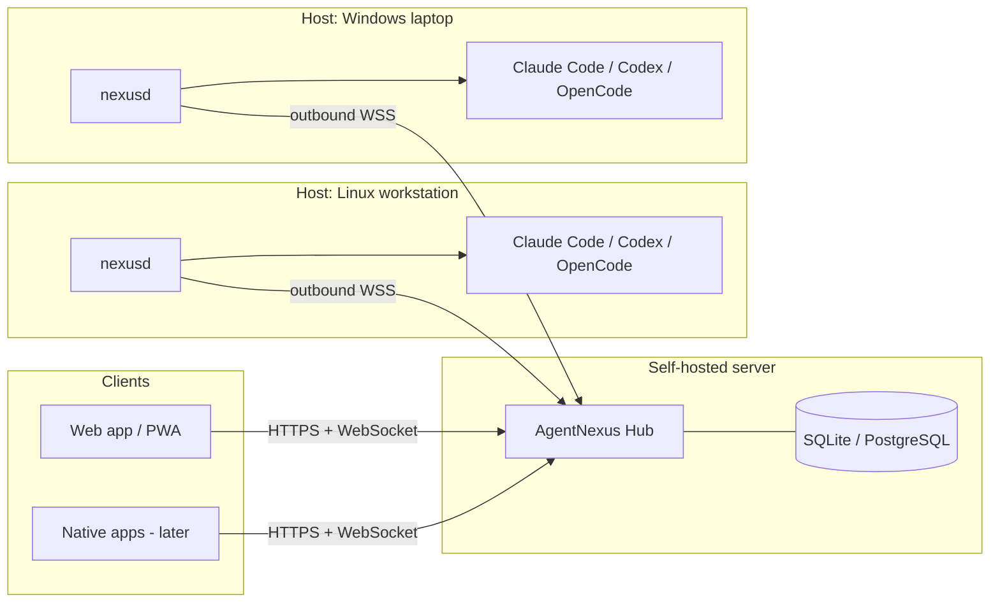

# AgentNexus

A self-hosted, multi-host web dashboard to discover, manage, and resume existing AI coding agent sessions across Windows, Linux, and macOS.

> **Project status: planning phase.** No application code exists yet. This repository currently contains the analysis, architecture and development plan. Implementation starts only after the planning documents below are accepted (see [Roadmap, Phase 0](docs/ROADMAP.md#phase-0--foundations-and-technical-spikes)).

## Why AgentNexus?

Developers increasingly run several terminal-based coding agents — Claude Code, Codex CLI, OpenCode, Gemini CLI and others — on several machines at once: a workstation, a laptop, a home server, a build box. Every agent keeps its own local session history in its own format, and every vendor offers (at most) its own single-agent remote access. Nobody gives you one place to answer:

- *Which agent sessions exist on which machine, in which project?*
- *Which of them is currently running, waiting for my approval, or finished?*
- *How do I continue that exact conversation from my phone or another computer — without breaking it for the native CLI?*

AgentNexus answers these questions with a **self-hosted hub** and a lightweight **host daemon** on each machine. It does not replace the agents and it does not copy or rewrite their histories: it discovers the sessions the agents already store and continues them through each agent's **own native resume mechanism**, so every session stays fully usable in the original CLI.

## Goals

1. **One overview** of all coding-agent sessions across all of your machines.
2. **Native continuation**: resume existing sessions exactly as the agent's own `--resume` would, from any browser.
3. **Self-hosted and private**: no third-party cloud, no telemetry, conversation content stays on your hosts by default.
4. **Cross-platform**: first-class support for Windows, Linux and macOS hosts.
5. **Safe remote control**: explicit device pairing, least-privilege host policies, approvals and audit logging — remote access to a coding agent is remote code execution and is treated as such.

## Key features (planned)

| Area | Feature | Planned in |
| --- | --- | --- |
| Hosts | Pair Windows, Linux and macOS machines; online status, versions, installed agents | [Phase 1](docs/ROADMAP.md#phase-1--hub-host-daemon-and-pairing) |
| Discovery | Find existing sessions created outside AgentNexus, with project, title, timestamps and live state | [Phase 2](docs/ROADMAP.md#phase-2--session-discovery-and-transcript-viewer) |
| History | Read-only transcript viewer; cross-host search and filters | [Phase 2](docs/ROADMAP.md#phase-2--session-discovery-and-transcript-viewer) |
| Resume | Continue a session natively in a browser terminal (full agent TUI) | [Phase 3](docs/ROADMAP.md#phase-3--native-resume-in-terminal-mode-mvp) |
| Sessions | Start new sessions and fork existing ones on any paired host | [Phase 3](docs/ROADMAP.md#phase-3--native-resume-in-terminal-mode-mvp) |
| Interaction | Structured chat mode with tool cards, diffs, interrupt and remote approvals | [Phase 4](docs/ROADMAP.md#phase-4--structured-mode-approvals-and-notifications) |
| Notifications | Push notifications when an agent needs input, finishes or fails | [Phase 4](docs/ROADMAP.md#phase-4--structured-mode-approvals-and-notifications) |
| Security | Passkeys, device pairing, host policies, audit log, optional signed-command mode | [Phase 1](docs/ROADMAP.md#phase-1--hub-host-daemon-and-pairing) – [Phase 5](docs/ROADMAP.md#phase-5--hardening-multi-user-and-10) |
| Extensibility | Generic adapter for agents speaking the Agent Client Protocol (ACP) | [Phase 6](docs/ROADMAP.md#phase-6--additional-agents-and-native-apps) |

## Supported platforms

| Component | Linux | macOS | Windows | Notes |
| --- | --- | --- | --- | --- |
| Hub (server) | ✅ x86_64, arm64 | ✅ (development) | ✅ (development) | Production target: Linux container or single binary |
| Host daemon `nexusd` | ✅ x86_64, arm64 | ✅ Apple Silicon, Intel | ✅ x86_64, arm64 (Windows 10 1809+ for ConPTY) | Runs as the logged-in user, not as root/SYSTEM |
| Web app | Current Chrome/Edge, Firefox, Safari — desktop and mobile, installable as PWA | | | |
| Native apps | Optional, later phase ([Phase 6](docs/ROADMAP.md#phase-6--additional-agents-and-native-apps)) | | | |

WSL distributions are supported by running a separate `nexusd` inside the distribution (see [Architecture](docs/ARCHITECTURE.md#13-platform-specifics)).

## Supported coding agents (planned)

| Agent | Discovery of existing sessions | Native resume (terminal) | Structured mode | Target phase |
| --- | --- | --- | --- | --- |
| Claude Code | ✅ planned | ✅ `claude --resume <id>` | via ACP adapter | 2–4 |
| Codex CLI | ✅ planned | ✅ `codex resume <id>` | via `codex app-server` | 2–4 |
| OpenCode | ✅ planned | ✅ `opencode --session <id>` | via `opencode serve` | 2–4 |
| Gemini CLI | ⚠️ planned, project-scoped | ✅ `gemini --resume <id>` | via ACP | 6 |
| Other ACP agents (GitHub Copilot CLI, Goose, Cursor CLI, Qwen Code, …) | ⚠️ only if the agent implements `session/list` | ⚠️ agent-specific | via ACP | 6 |

Details, verification status and risks per agent: [docs/AGENT-INTEGRATIONS.md](docs/AGENT-INTEGRATIONS.md).

## Architecture at a glance

Hosts only make **outbound** connections to the hub; no ports need to be opened on your machines. See [docs/ARCHITECTURE.md](docs/ARCHITECTURE.md).

## Documentation

| Document | Content |
| --- | --- |
| [docs/PLAN.md](docs/PLAN.md) | Requirements, technical decisions (ADRs) and implementation steps |
| [docs/ARCHITECTURE.md](docs/ARCHITECTURE.md) | System architecture, components, protocols, data model, diagrams |
| [docs/ROADMAP.md](docs/ROADMAP.md) | Phases, priorities, milestones, dependencies and acceptance criteria |
| [docs/AGENT-INTEGRATIONS.md](docs/AGENT-INTEGRATIONS.md) | Per-agent analysis: session discovery and native resume |
| [docs/SECURITY.md](docs/SECURITY.md) | Threat model, authentication, pairing, encryption, permissions, vulnerability reporting |

## Non-goals

- Hosting or running coding agents in a cloud, or providing LLM credentials. Each host uses its own locally installed and logged-in agents.
- Converting sessions between different agents or editing agent transcripts.
- Replacing the agents' own terminal UIs. AgentNexus embeds them (terminal mode) or drives their official programmatic interfaces (structured mode).

## License

[MIT](LICENSE) © 2026 AlexanderWagnerDev
