# AgentNexus

A self-hosted control plane to discover, manage, and continue existing AI coding-agent sessions across Windows, Linux, and macOS.

> **Status: alpha.** There is no official version and no published release yet. Hub, host daemon, SAS host pairing, native session discovery, terminal resume, OpenCode/Codex structured chat, Claude through an ACP adapter, structured OpenCode/Codex/ACP forks, projects, pinned sessions, notification inbox and external channels, passkeys, Web Push with per-host preferences, transcript export and search, read-only Git review with live refresh, prompt templates and a durable prompt queue, a task board with dependencies and delegation, token/cost usage, multi-agent fan-out, project activity heatmaps, a keyboard shortcut overview, multi-user grants, a two-pane workspace, hub-signed and replay-protected host commands, signed and checksum-verified host auto-updates with idle gating and rollback, Windows process-tree termination, optional Prometheus metrics, a tested agent version matrix, host health and detail views, pixel-diff visual regression, a read-only MCP endpoint, the `nexus` terminal client and an English/German interface are implemented and runnable. Opt-in device-signed commands with replay protection are implemented for native clients; the browser UI remains cookie-authenticated. PostgreSQL and native apps are not implemented; real Claude/Gemini interactions and deployment on three physical hosts have not been verified here. These are factual limitations, not release prerequisites. See [What works today](#what-works-today), [VERIFICATION.md](docs/VERIFICATION.md) and [Roadmap status](#roadmap-status).

**No releases or tags are published during alpha.** All earlier pre-release
tags and GitHub releases were withdrawn before the first official version was
approved. The repository is intentionally public. Official tags and releases require
explicit maintainer approval, not extended stress runs or personal tests. See
[docs/RELEASING.md](docs/RELEASING.md) for the locked procedure.

## Why AgentNexus?

Developers increasingly run several terminal-based coding agents — Claude Code, Codex CLI, OpenCode, Gemini CLI and others — on several machines at once: a workstation, a laptop, a home server, a build box. Every agent keeps its own local session history in its own format, and every vendor offers (at most) its own single-agent remote access. Nobody gives you one place to answer:

- *Which agent sessions exist on which machine, in which project?*
- *Which of them is currently running, waiting for my approval, or finished?*
- *How do I continue that exact conversation from my phone or another computer — without breaking it for the native CLI?*

AgentNexus answers these questions with a **self-hosted hub** and a lightweight **host daemon** on each machine. It does not replace the agents and it does not copy or rewrite their histories: it discovers the sessions the agents already store and continues them through each agent's **native resume mechanism**, so every session stays fully usable in the original CLI.

## Screenshots

| Dark | Light |
| --- | --- |
| 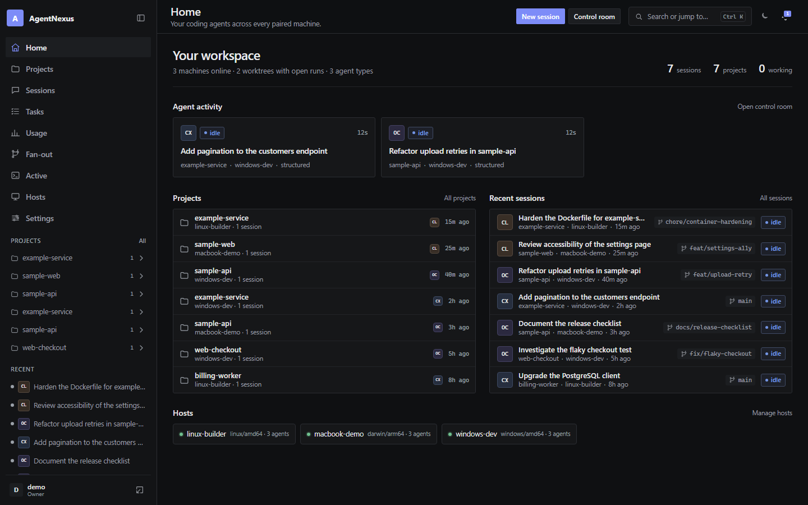 | 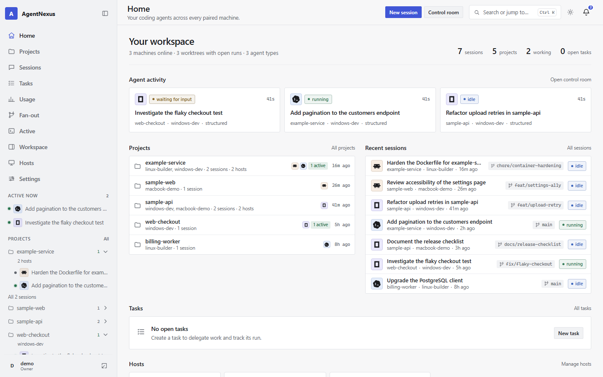 |
| 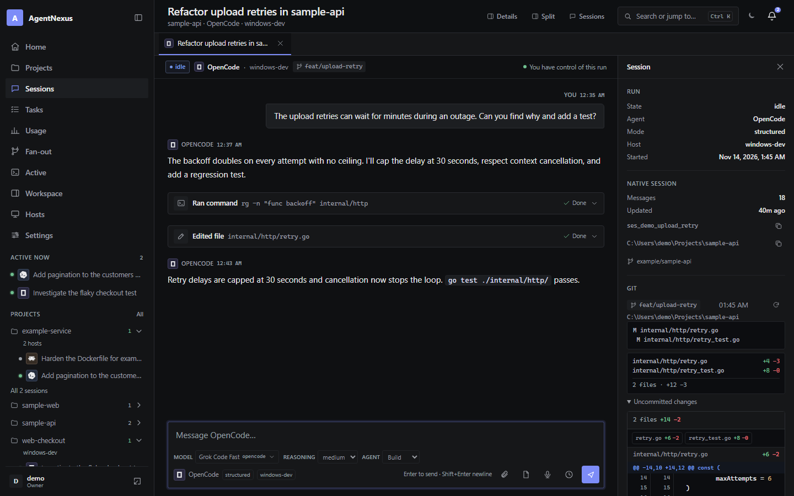 | 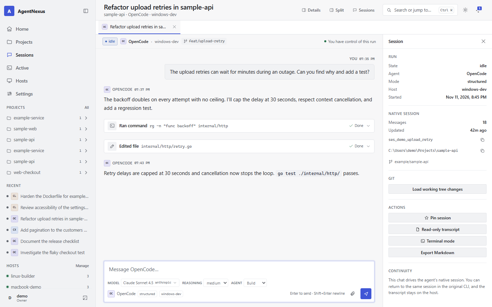 |
| 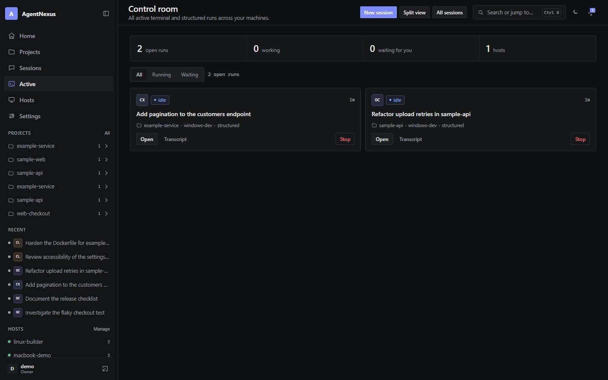 | 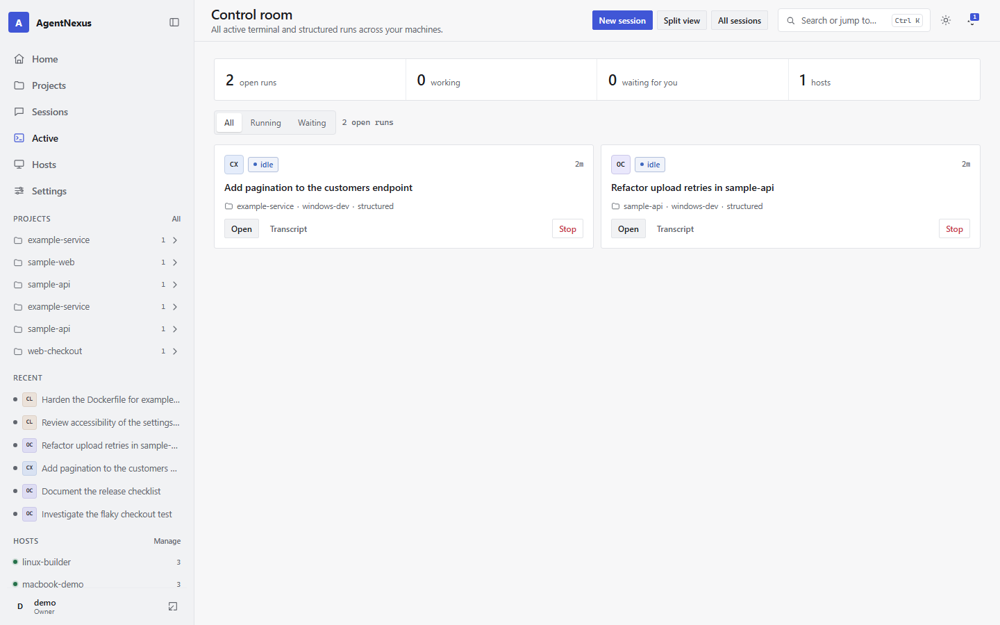 |
| 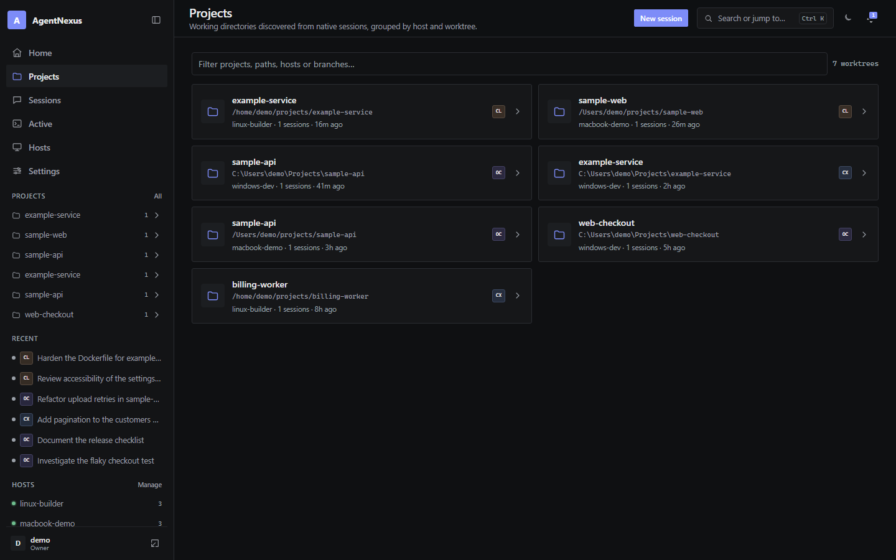 | 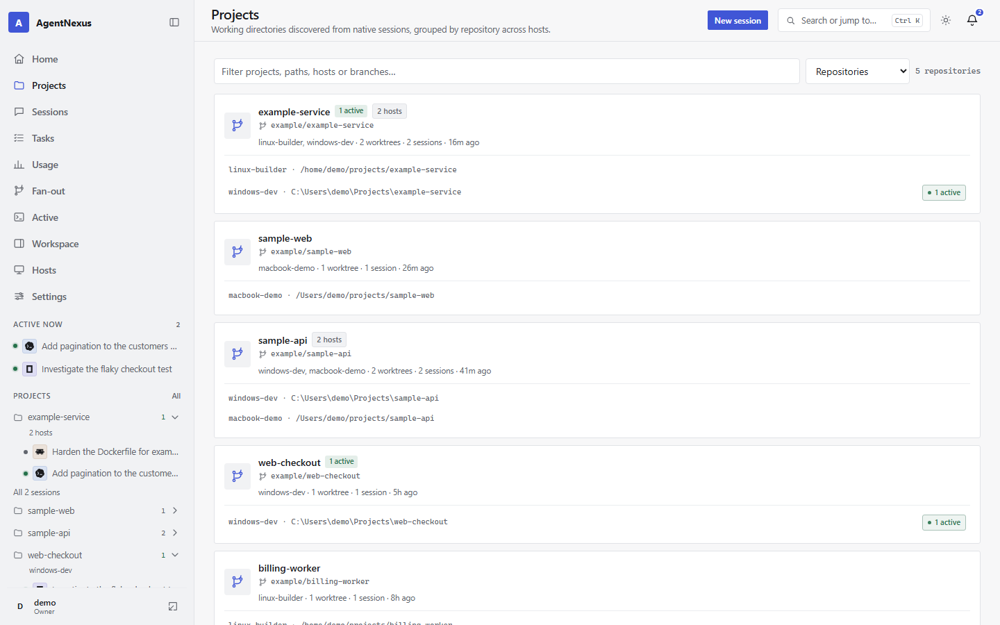 |
| 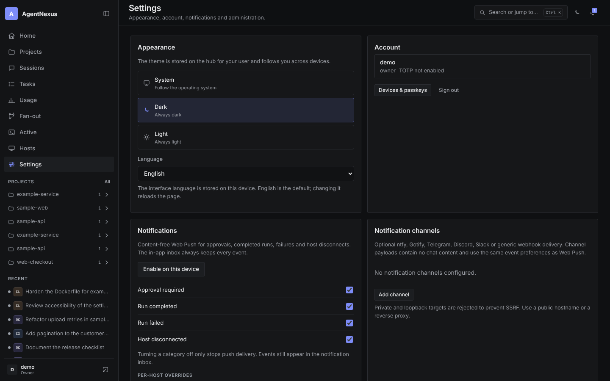 | 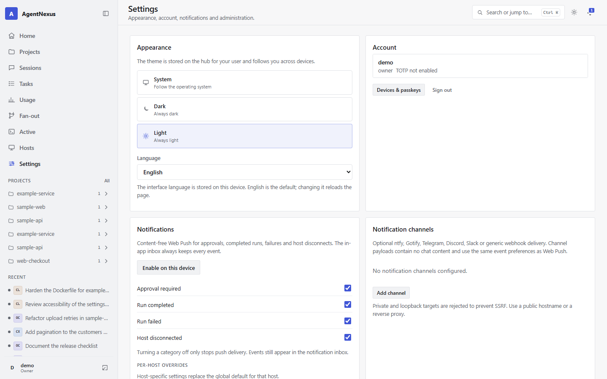 |
| 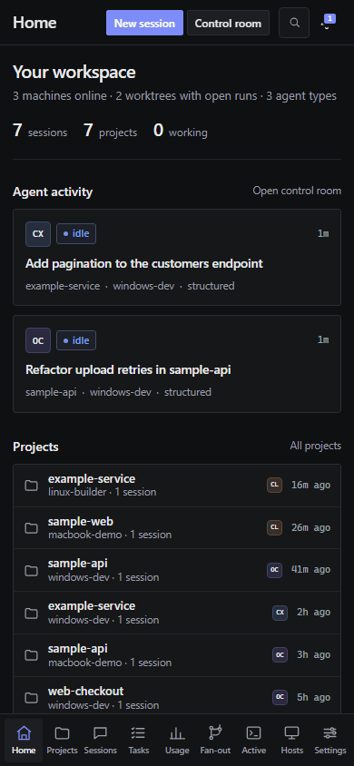 | 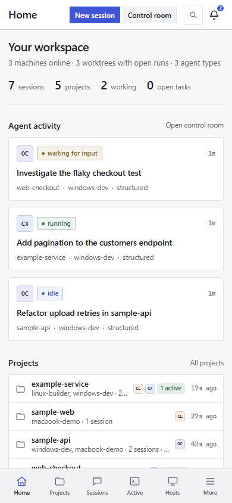 |
| 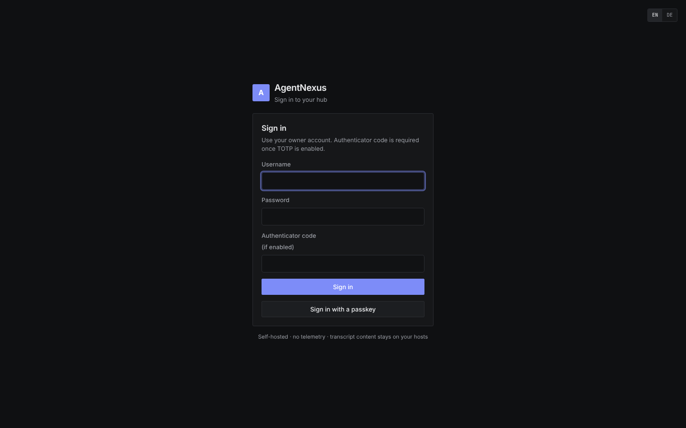 | 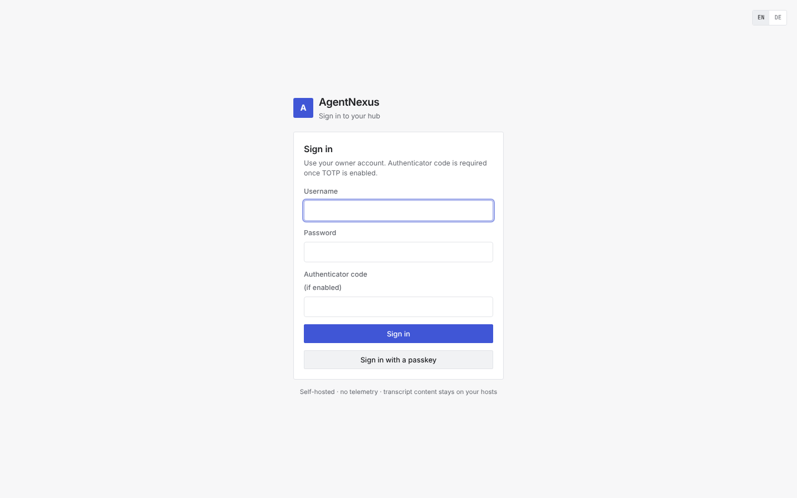 |

The screenshots come from a running hub whose hosts are synthetic fixtures from
`cmd/nexus-demo`: three simulated machines, fake native sessions and harmless
tool output. They show the real UI, renderer and diff engine, but no real user,
host, path or project data. The same UI is used on desktop, tablet and phone,
and the theme is stored per user on the hub. See
[docs/PRIVACY.md](docs/PRIVACY.md) for the demo-data rules.

More views: [split workspace](docs/screenshots/workspace-dark.png),
[split workspace in light mode](docs/screenshots/workspace-light.png),
[searchable model picker](docs/screenshots/model-picker-dark.png),
[split workspace on a phone](docs/screenshots/workspace-mobile.png),
[model, reasoning and attachment composer](docs/screenshots/chat-composer-dark.png),
[side-by-side diff](docs/screenshots/diff-split-dark.png),
[side-by-side diff in light mode](docs/screenshots/diff-split-light.png),
[tool-call cards](docs/screenshots/chat-tools-dark.png),
[approval request](docs/screenshots/chat-approval-dark.png),
[Git context panel](docs/screenshots/chat-context-dark.png),
[rendered diff](docs/screenshots/chat-diff-dark.png),
[notifications](docs/screenshots/notifications-dark.png),
[mobile chat](docs/screenshots/mobile-chat.png),
[mobile chat in light mode](docs/screenshots/mobile-chat-light.png),
[mobile chat details](docs/screenshots/mobile-chat-details.png),
[hosts](docs/screenshots/hosts-dark.png),
[session transcript](docs/screenshots/session-detail-dark.png) and the
[command palette](docs/screenshots/command-palette.png).

## What works today

| Area | Status |
| --- | --- |
| **Hub** (`nexus-hub`) | Go binary, SQLite metadata store, embedded web app, health endpoints, structured JSON logs |
| **First-run setup** | Owner account, Argon2id password hashing, server-side sessions, optional TOTP enrollment |
| **Host pairing** | One-time code (10 min, single use), Ed25519 host identity, SAS confirmation, challenge-response over an outbound WebSocket |
| **Hosts** | Online/offline/disabled, OS/arch, daemon version, detected agents with versions and tested-band warnings, local search-index progress, rename, disable/enable, revoke |
| **Session sync** | Capability-negotiated incremental snapshots; full snapshots after reconnect; no full-table rewrite while one session is active; mtime fingerprint of agent stores with a 500 ms debounce and a 15 s fallback (new sessions normally appear within 2-3 s) |
| **Command signing** | Hub-to-host commands signed with Ed25519, replay nonces and a five-minute timestamp window; hosts pin the hub key. Native clients can register a per-device Ed25519/P-256 key; signed writes cover WebSocket prompt/approval/input/interrupt and the REST run, queue, task, fan-out and stop paths. The browser UI stays cookie-authenticated, and host-side verification of a *device* identity (independent of the hub) remains open |
| **Host updates** | Host-local auto-update: checks GitHub releases directly, stable/prerelease/development channels, ETag caching, jitter and backoff, SHA-256 plus cosign verification (checksum-only only when explicitly configured), waits for idle runs, restarts the user service, verifies the new version and rolls back on repeated start failures; status is visible in the hub. Identity, config and native agent stores are preserved | No public release feed during alpha. The `development` update channel follows the prerelease release feed; unsigned CI development builds are only available through the installer's explicit `--development` path, not through auto-update |
| **Secrets** | TOTP secrets and the VAPID private key encrypted at rest with AES-256-GCM and a local `secret.key`; legacy values are migrated on startup |
| **Backups** | Online SQLite snapshots via `nexus-hub -backup`, with documented restore and rollback |
| **Passkeys** | WebAuthn registration/login with username-first flow; password + optional TOTP remains as fallback |
| **Devices** | Per-browser sessions with last-seen metadata, individual revocation, step-up-protected "sign out all other devices", revoked-device labels, and expired-session cleanup at hub start |
| **Device pairing** | QR/link pairing from a signed-in device, single-use 2-minute token |
| **Discovery** | Existing Claude Code (JSONL), Codex CLI (JSONL + zstd rollouts) and OpenCode (SQLite) sessions; best-effort Gemini CLI |
| **Home** | Workspace summary, open agent activity, projects, recent sessions and host status |
| **Projects** | Sessions grouped by normalized working directory, with branch, agents and active counts; identical remotes are recognized across hosts and worktrees are counted |
| **Favorites** | Per-user pinned sessions reflected in the sidebar and session/chat headers |
| **Local metadata** | Per-user session tags and local titles, tag filter, inline title editor and command-palette display; native titles and transcripts are never changed |
| **Themes** | Dark, light and system mode; stored per user on the hub, with an initial system-colored login screen |
| **Languages** | English (default) and German interface; selectable on the login screen or under Settings, stored per browser, with `<html lang>` and date/number locale following the choice |
| **Navigation** | Collapsible desktop sidebar, mobile bottom navigation, session tabs and a `Ctrl/Cmd+K` command palette |
| **Transcripts** | Read-only, paged, Markdown-rendered messages, collapsible tool cards and reasoning; fetched on demand from the host |
| **Export** | Full transcript as Markdown or JSON, fetched page-by-page from the host and bounded at 10,000 messages |
| **Control room** | Live view of every open terminal/structured run with state, elapsed time, shared-worktree warnings and quick stop |
| **Run limits** | Optional per-host, per-user and per-project concurrency ceilings enforced before a run reaches the host (HTTP 429 `run_limit`), plus a 100-item prompt-queue cap; all limits are off by default and configurable through flags or environment variables |
| **Run diagnostics** | Stable error codes (`network`, `authentication`, `authorization`, `agent_unavailable`, `unsupported_version`, `session_conflict`, `host_policy`, `agent_protocol`, `process_crash`, `timeout`, `database`, `update`, `internal`) persisted with the observed message; run pages show the code and the original agent/host text |
| **Host doctor** | On-demand, host-authorized checks for pairing, identity, signing, hub health, policy roots/agents, detected agents and search index; the web response contains no paths, host ids, keys or configuration values |
| **Split workspace** | Two independent live chats side by side or stacked, resizable and persisted, with per-pane approvals and mobile stacking |
| **Chat** | Streaming text, Markdown/GFM tables, footnotes, nested task lists, highlighted code blocks with copy, tool summaries, reasoning, approvals, a resizable context panel and unified/side-by-side diffs with line numbers and file navigation |
| **Composer** | Auto-growing input, persistent per-run drafts, Enter/Shift+Enter behavior, interrupt, a searchable model picker with favorites/recent models, live reasoning/agent selectors and bounded attachments gated by real capabilities; ACP agents expose only what they advertise; optional Web Speech dictation follows the UI language, inserts editable text and never sends automatically |
| **Terminal client** | `nexus login`, `sessions`, `attach`, `approve` and a checksum/signature-verified `nexus update` that never replaces the daemon; revocable device session stored with mode 0600, WebSocket attach and controller lease, line-mode input, Windows/Linux/macOS builds |
| **Read-only MCP** | Stateless `/mcp` JSON-RPC endpoint with scoped bearer tokens and rate limiting; tools list hosts/sessions, search transcripts, read transcript pages and Git status without any write path |
| **Notification channels** | Optional ntfy, Gotify, Telegram, Discord, Slack and generic webhook delivery for the same content-free events as Web Push; configurations are AES-GCM encrypted, private/loopback SSRF targets are blocked, sends have timeouts, one bounded retry and a test action |
| **Templates** | Saved prompt snippets with `{{branch}}`, `{{project}}` and `{{selection}}` variables, search, insert, edit and delete; admins can share a template with every user, and `/tpl <name>` expands one in the composer |
| **Prompt queue** | Persistent per-run queue for structured runs: schedule, reorder, edit, remove, pause/resume, automatic delivery only after an idle transition, controller-lease and permission re-checks before every send, and crash recovery that fails in-flight items instead of retrying them |
| **Keyboard shortcuts** | Central `?` overview plus `g` navigation sequences, `Ctrl/⌘+K` palette, tab switching, details toggle, approval keys, interrupt, Escape and split-resizer arrows |
| **Project activity** | 90-day heatmap per project with sessions, runs, agents and hosts; clicking a day opens the matching filtered session list |
| **Fan-out** | Start the same prompt on up to eight independent native structured sessions across hosts, with per-target status, session links, changes review, changed-file counts, shared-file overlap warnings and isolated failures; duplicate host/worktree targets are rejected |
| **Tasks** | Per-user task board with draft/ready/queued/running/waiting/blocked/completed/failed/cancelled states, optional dependencies with cycle detection, and delegation that starts a native structured session and delivers the task prompt through the durable queue; run lifecycle and approvals update the task, and orphaned tasks are reconciled on hub restart |
| **Usage** | Token and cost metadata reported by Codex (`thread/tokenUsage/updated`), OpenCode (`session.usage.recorded`) and ACP adapters (`usage` on prompt responses); aggregates by run, session, agent, host, project and day with 7/30/90/365-day filters. Missing values are marked unavailable; no prices are estimated |
| **Search** | Federated transcript search across online hosts with a host-local FTS5 index (BM25 ranking, snippets), adapter fallback while indexing and agent/host filters; offline hosts are reported, not silently skipped |
| **Session browse** | Server-side sort (`updated`, `created`, `title`, `messages`), order, RFC 3339 `since`/`until`, 24 h/7 d/30 d/custom UI filters and a tag filter; filter state lives in the URL, and a windowed virtual list renders only visible rows with automatic page loading (tested with 10,000 sessions) |
| **Terminal mode** | Resume an existing native session, start a new one, or fork where the agent supports it; PTY/ConPTY streamed to xterm.js; stopping a run terminates the whole process tree (Unix process group, Windows Job Object with a suspended-start handshake); a bounded 1 MiB per-run ring buffer replays output after a hub outage |
| **Structured mode** | OpenCode 2.2.x (including native forks), Codex, plus any ACP adapter (for example `claude-agent-acp`), with the same chat experience |
| **Notifications** | In-app history with read state, host and agent filters, plus content-free Web Push for approvals, completion, failures and disconnects; push categories can be switched off per user and overridden per host without losing inbox events |
| **Reconnects** | Jittered browser backoff, hub-epoch detection after restart, buffered events during history load and replay of missed run events |
| **Git review** | Read-only branch, status, diff stat and rendered diff in a session's working tree, executed on the host; includes staged and unstaged tracked changes plus new/deleted files in the status, bounds large output with visible truncation, and opens a full-width changes page with unified and split layouts; the chat details panel refreshes the working tree every five seconds while a run is active and refreshes once more when it goes idle, without flicker or discarding a readable diff on a transient host error |
| **Observability** | Optional token-protected `/metrics` with host/browser/run gauges, per-route HTTP counters and duration summaries, reconnect/push-failure counters and approval latency; request IDs and route-only structured logs never include query strings or transcript content |
| **PWA** | Manifest, service worker, maskable PNG icons, installable on desktop and mobile |
| **Multi-user** | Owner/admin/member/viewer roles, per-host grants, user management, device revocation |
| **Concurrency guard** | One AgentNexus run per native session on a host; explicit controller lease for input; best-effort detection of sessions open in a native terminal with an Attach / read-only / Fork / forced-step-up conflict dialog and an audit entry for forced resumes |
| **Host policy** | `allowed_roots`, `allowed_agents`, new/fork switches and forbidden permission-bypass flags, enforced on the host |
| **Audit** | Append-only, hash-chained hub audit log with verification in the UI/API |
| **Host sharing** | Per-host grants for `view`, `read_transcript`, `resume`, `create`, `fork`, `terminal_input`, `approve`, `manage` |
| **Operations** | Multi-arch GHCR and Docker Hub image, Docker Compose with Caddy, Portainer stack, per-user services (systemd user unit, launchd agent, Windows Task Scheduler task with crash restart), `nexusd doctor` |

### Agent support in the alpha

| Agent | Discovery | Transcript | Terminal resume | Structured | New | Fork |
| --- | --- | --- | --- | --- | --- | --- |
| Claude Code | ✅ JSONL store | ✅ | ✅ `claude --resume <id>` | ✅ via ACP adapter (`claude-agent-acp`) | ✅ | ✅ `--fork-session` |
| Codex CLI | ✅ rollouts (`.jsonl`, `.jsonl.zst`) | ✅ | ✅ `codex resume <id>` | ✅ implemented (`app-server`) | ✅ | ✅ `codex fork <id>`; structured `thread/fork` |
| OpenCode | ✅ SQLite store (v1 + v2) | ✅ | ✅ `opencode --session <id>` | ✅ implemented (`serve`) | ✅ | ✅ structured (`POST /api/session/{id}/fork`); no terminal fork |
| Gemini CLI | ⚠️ best effort | ⚠️ best effort | ✅ `gemini --resume <id>` | ⚠️ ACP via `gemini --acp` (fake-tested, not real-tested) | ✅ | ❌ |

A tested version band is recorded per agent in `internal/host/versions.go` and
mirrored in [docs/AGENT-INTEGRATIONS.md](docs/AGENT-INTEGRATIONS.md). A detected
version outside the band disables structured mode with a visible warning while
terminal mode keeps working; `allow_untested_agent_versions` overrides this and
is audited. Unknown versions are warned about but not disabled.

Claude Code discovery/transcript code is fixture-tested; the Claude CLI and adapter were **not installed** in the test environment, so the Claude ACP path is not proven against a real Claude session. Codex CLI 0.156.1 and OpenCode 2.2.7 were exercised against real local stores on Windows 11; Linux and macOS CI runs build and unit-test the code but no real agent session was run there. Gemini CLI is not installed in the test environment; its ACP path is the generic ACP driver with an explicit `nexusd acp --agent gemini --command "gemini --acp"` configuration and is not verified against a real Gemini version. Agent formats change often — treat them as pinned-by-tests, not permanent contracts.

## Quick start

### Install a host client (no Go toolchain)

The installers use official GitHub releases by default: they download the
platform archive, verify its SHA-256 (and the cosign bundle when cosign is
installed) and install both `nexusd` and `nexus`. No GitHub CLI is required for
a public release.

```powershell
# Windows
powershell -ExecutionPolicy Bypass -File scripts\install-host.ps1 `
  -Hub https://nexus.example.com -Code XXXX-XXXX -Name my-laptop
```

```bash
# Linux / macOS
./scripts/install-host.sh --hub https://nexus.example.com --code XXXX-XXXX --name build-box
```

During alpha there is no public release yet. Use `-Development` (PowerShell) or
`--development` (shell) to install the newest CI build as an explicit fallback;
that path requires `gh auth login`. A source build still works when Go 1.26.11+
is available:

```bash
make build          # produces bin/nexus-hub, bin/nexusd and bin/nexus
```

Container builds from `main` are published as development images only:

```bash
docker pull ghcr.io/alexanderwagnerdev/agent-nexus:alpha
```

The `alpha` tag moves with `main` and is not an official release. Use a
`sha-<short>` tag for a pinned build.

See [docs/INSTALL.md](docs/INSTALL.md) for Docker Compose, Portainer, Windows,
Linux and macOS host-client installation.

Requirements: Go 1.26.11+ and Node.js only for the JavaScript syntax check (the browser client is embedded and has no build step).

```bash
# 1. Run the hub locally
./bin/nexus-hub --addr 127.0.0.1:8080 --data-dir ./.nexus

# 2. Open http://127.0.0.1:8080, create the owner account.
#    Save the TOTP secret shown after setup if you want a second factor.

# 3. In the web UI: Hosts -> "Pair a host" -> copy the command.
# 4. On the machine that runs your agents:
./bin/nexusd pair --hub http://127.0.0.1:8080 --code XXXX-XXXX --name my-laptop
# Compare the printed Pairing SAS with the code shown on the Hosts page,
# then click "Confirm host" there.
./bin/nexusd service install
./bin/nexusd doctor
# Optional: give Claude Code the structured chat UI through an ACP adapter.
# claude-agent-acp and claude-code-acp are auto-detected on PATH.
./bin/nexusd acp --agent claude --command claude-agent-acp
```

The host connects **outbound only**; no ports need to be opened on your machines.

### Docker with Caddy

```bash
cp .env.example .env      # set HUB_DOMAIN and HUB_NAME
docker compose pull
docker compose up -d
```

To build the image from this checkout instead of pulling it, add the development
override: `docker compose -f compose.yaml -f compose.build.yaml up -d --build`.

Caddy terminates TLS; the hub is not exposed directly. See [deploy/Caddyfile](deploy/Caddyfile). Multi-arch development images are published to GHCR (`ghcr.io/alexanderwagnerdev/agent-nexus:alpha`) and Docker Hub (`alexanderwagnerdev/agent-nexus:alpha`); see [docs/OPERATIONS.md](docs/OPERATIONS.md) for Portainer and reverse-proxy setups.

## Host updates

Each `nexusd` installation checks the official release feed directly (never
through the hub) at startup and every six hours with jitter, ETag caching and
exponential backoff. On the `stable` channel only non-prerelease releases are
accepted. Updates are staged, SHA-256 verified and cosign-verified before
installation; checksum-only is an explicit local setting, not a silent fallback.

The default local policy is:

```json
{
  "updates": {
    "channel": "stable",
    "check_interval_minutes": 360,
    "install_when_idle": true,
    "require_signature": true,
    "allow_remote_install": false
  }
}
```

Automatic installation waits until no terminal, structured or ACP run is active,
blocks new runs during the replacement, restarts the per-user service and
verifies the new version. Repeated failed starts roll back to
`nexusd.previous`, and the failed version is blocked until an operator removes
it. The hub can display the state and, only when `allow_remote_install` is
enabled locally, request installation; it cannot change the channel, signature
policy or trusted source.

```bash
nexusd update --status
nexusd update --check
nexusd update --configure --channel stable --auto on --install-when-idle on
nexusd update --configure --checksum-only   # explicit weaker trust mode
nexusd update --rollback
```

See [docs/INSTALL.md](docs/INSTALL.md#31-host-updates) and
[docs/OPERATIONS.md](docs/OPERATIONS.md#host-updates).

## Security

Remote control of a coding agent is remote code execution. AgentNexus treats it that way:

- Hosts connect outbound; the hub never opens a port on a host.
- Host identity is an Ed25519 key generated at pairing; every connection is authenticated with a challenge-response.
- Host policy is configured **on the host** and cannot be overridden by the hub. Permission-bypass flags are rejected locally.
- The hub stores metadata only. Transcript content is fetched on demand and is not persisted on the hub.
- Passwords use Argon2id; TOTP is available as a second factor; sessions are HttpOnly, SameSite=Strict (and Secure with TLS). Sensitive actions require a five-minute step-up confirmation.
- Security-relevant actions go to a hash-chained hub audit log and a local JSONL host audit log.

**Before exposing the hub to the internet**, put it behind a TLS reverse proxy, register a passkey, keep a strong password + TOTP fallback, and read [docs/SECURITY.md](docs/SECURITY.md). This alpha build has not received an external security audit. Hub-to-host commands are signed and native clients can opt into device-signed writes, but the browser UI remains cookie-authenticated, host-side device-identity verification is not implemented, and PostgreSQL is not implemented; do not treat this as a 1.0 security posture. `/metrics` is disabled unless `NEXUS_METRICS=true` and `NEXUS_METRICS_TOKEN` is set.

Please report vulnerabilities privately — see [SECURITY.md](SECURITY.md).

CodeQL runs on every push and pull request. The workflow currently keeps the
SARIF results as 14-day workflow artifacts instead of publishing them to the
Security tab. Switch `upload: never` to `upload: always` in
`.github/workflows/codeql.yml` to upload them once code scanning is enabled for
the repository.

## Testing

```bash
go test ./...
go vet ./...
cd web && npm test          # Markdown and diff unit tests
E2E_SPAWN_HUB=1 npm run e2e # disposable hub + browser smoke test

# axe-core WCAG 2.2 A/AA scan against a running hub (desktop and mobile):
BASE_URL=http://127.0.0.1:8788 npm run e2e:a11y

# One real prompt against an existing structured run on a paired host:
BASE_URL=http://127.0.0.1:8788 RUN_ID=<run-id> npm run e2e:live
```

The live check requires a real OpenCode or Codex run and is intentionally not
part of CI. Large-store benchmarks:

```bash
go test ./internal/hub -run '^$' -bench 'Benchmark(Replace|List)Session' -benchtime=1x
```

## Architecture at a glance

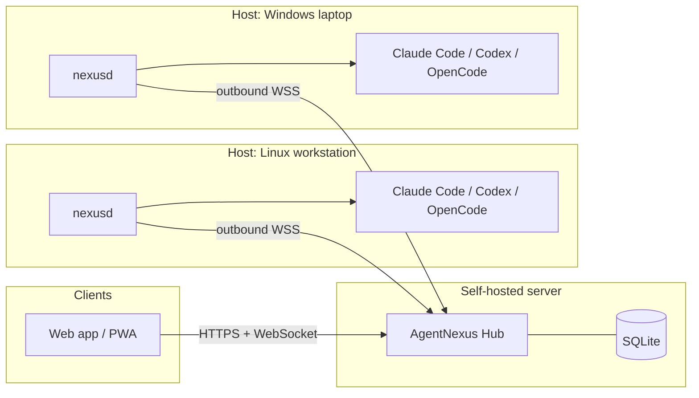

The host link carries JSON envelopes in this build; see [ADR-014](docs/PLAN.md#adr-014--json-host-link-and-dependency-light-web-client-for-the-alpha). Protobuf envelopes and a React migration remain future options.

## Repository layout

```text
cmd/nexus-hub/        hub entrypoint
cmd/nexusd/           host daemon entrypoint (pair, run, doctor, discover, update, service)
cmd/nexus/            terminal client entrypoint
internal/protocol/    shared wire types
internal/hub/         API, auth, host registry, session index, run relay, audit
internal/host/        discovery adapters, policy, PTY run manager, hub link
web/                  embedded browser client (vanilla ES modules + xterm.js)
deploy/               Caddy example
docs/                 requirements, architecture, roadmap, security, agent integrations
```

## Roadmap status

| Phase | Status |
| --- | --- |
| 0 — Foundations & spikes | ✅ scaffolding, CI, PTY and protocol prototypes; SP-1 to SP-5 reports in `docs/spikes/` |
| 1 — Hub, daemon, pairing | 🟡 core implemented; passkeys, host SAS confirmation and five-minute step-up confirmation available |
| 2 — Discovery & transcripts | 🟡 core implemented; host-local FTS5 index with adapter fallback and progress in the UI; mtime-based discovery with a five-second budget; live native-process detection is best effort |
| 3 — Terminal resume (MVP) | 🟡 implemented and manually exercised; process-tree termination is tested on Linux, macOS and Windows, including the suspended-start job handshake; per-agent/OS end-to-end matrix and WSL still open |
| 4 — Structured mode, approvals, push | 🟡 OpenCode/Codex structured modes, generic ACP with capability-driven controls, approvals, Web Push with per-category opt-outs, QR device pairing, host SAS confirmation, a tested agent version matrix and a 360 px mobile layout review implemented; automated axe-core WCAG scan clean |
| 5 — Hardening, multi-user, 1.0 | 🟡 roles, per-host grants, host rename/disable, hub command signing, optional Prometheus metrics and the signed GoReleaser/SBOM pipeline implemented; PostgreSQL and host-side verification of device-signed commands remain incomplete |
| 6 — Additional agents & native apps | 🟡 Gemini discovery is best effort; read-only git status/diff and generic ACP agent support implemented; native apps not implemented |

Detailed acceptance criteria remain in [docs/ROADMAP.md](docs/ROADMAP.md). The status table reflects what the code does, not what the roadmap intends.

## Documentation

| Document | Content |
| --- | --- |
| [docs/INSTALL.md](docs/INSTALL.md) | Beginner installation: Docker/Portainer, host clients, pairing, first chat |
| [docs/MULTI-HOST.md](docs/MULTI-HOST.md) | Three Windows hosts + Portainer + MacBook/phone: setup, verification, updates |
| [docs/ADMIN.md](docs/ADMIN.md) | Day-2 administration: users, grants, host policy, audit, updates, limitations |
| [docs/UI-DESIGN.md](docs/UI-DESIGN.md) | Design references, tokens, chat/composer rules and remaining UI gaps |
| [docs/PLAN.md](docs/PLAN.md) | Requirements, technical decisions (ADRs), work packages |
| [docs/ARCHITECTURE.md](docs/ARCHITECTURE.md) | Components, protocols, data model, diagrams |
| [docs/ROADMAP.md](docs/ROADMAP.md) | Phases, priorities, milestones, acceptance criteria |
| [docs/AGENT-INTEGRATIONS.md](docs/AGENT-INTEGRATIONS.md) | Per-agent session storage and native resume details |
| [docs/SECURITY.md](docs/SECURITY.md) | Threat model, pairing, permissions, deployment hardening |
| [docs/OPERATIONS.md](docs/OPERATIONS.md) | Data locations, backup/restore, upgrade, proxy, troubleshooting |
| [docs/RELEASING.md](docs/RELEASING.md) | Alpha release policy and the locked manual release procedure |
| [docs/PRIVACY.md](docs/PRIVACY.md) | Public identity, screenshot rules and the pre-publication privacy checklist |
| [docs/WSL.md](docs/WSL.md) | Running `nexusd` inside WSL as a separate host |
| [SECURITY.md](SECURITY.md) | How to report a vulnerability |

## Non-goals

- Hosting or running coding agents in a cloud, or providing LLM credentials. Each host uses its own locally installed and logged-in agents.
- Converting sessions between different agents or editing agent transcripts.
- Replacing the agents' own terminal UIs for terminal mode.

## License

[MIT](LICENSE) © 2026 AlexanderWagnerDev
