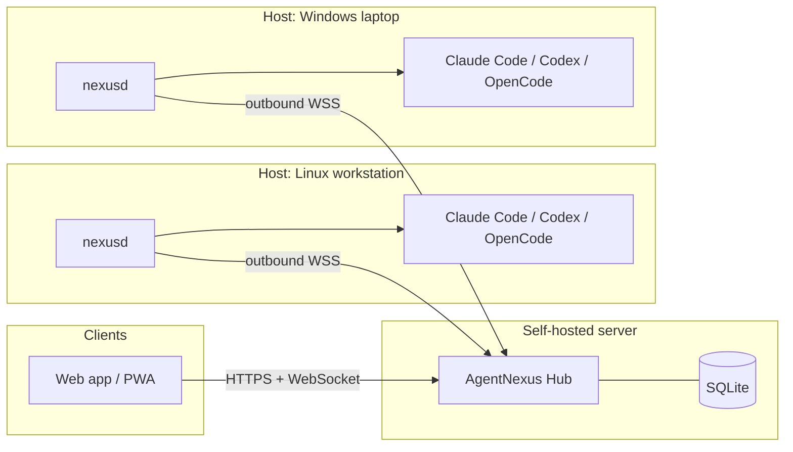

# AgentNexus

A self-hosted, multi-host web dashboard to discover, manage, and resume existing AI coding agent sessions across Windows, Linux, and macOS.

> **Status: 0.1.0-dev implementation.** Hub, host daemon, pairing, discovery, transcripts, federated search, terminal resume, OpenCode structured mode, passkeys, Web Push and multi-user grants are implemented and runnable. Signed-command mode, PostgreSQL, native apps, Claude/Codex structured drivers and an external security audit remain open. See [What works today](#what-works-today) and [Roadmap status](#roadmap-status).

## Why AgentNexus?

Developers increasingly run several terminal-based coding agents — Claude Code, Codex CLI, OpenCode, Gemini CLI and others — on several machines at once: a workstation, a laptop, a home server, a build box. Every agent keeps its own local session history in its own format, and every vendor offers (at most) its own single-agent remote access. Nobody gives you one place to answer:

- *Which agent sessions exist on which machine, in which project?*
- *Which of them is currently running, waiting for my approval, or finished?*
- *How do I continue that exact conversation from my phone or another computer — without breaking it for the native CLI?*

AgentNexus answers these questions with a **self-hosted hub** and a lightweight **host daemon** on each machine. It does not replace the agents and it does not copy or rewrite their histories: it discovers the sessions the agents already store and continues them through each agent's **native resume mechanism**, so every session stays fully usable in the original CLI.

## What works today

| Area | Status |
| --- | --- |
| **Hub** (`nexus-hub`) | Go binary, SQLite metadata store, embedded web app, health endpoints, structured JSON logs |
| **First-run setup** | Owner account, Argon2id password hashing, server-side sessions, optional TOTP enrollment |
| **Host pairing** | One-time code (10 min, single use), Ed25519 host identity, challenge-response over an outbound WebSocket |
| **Hosts** | Online/offline, OS/arch, daemon version, detected agents with versions, revoke |
| **Passkeys** | WebAuthn registration/login with username-first flow; password + optional TOTP remains as fallback |
| **Device pairing** | QR/link pairing from a signed-in device, single-use 2-minute token |
| **Discovery** | Existing Claude Code (JSONL), Codex CLI (JSONL + zstd rollouts) and OpenCode (SQLite) sessions; best-effort Gemini CLI |
| **Overview** | Cross-host session list with title, project, agent, state and last activity |
| **Transcripts** | Read-only, paged, tool calls collapsible; fetched on demand from the host, never stored on the hub |
| **Search** | Federated search across online hosts; offline hosts are reported, not silently skipped |
| **Terminal mode** | Resume an existing native session, start a new one, or fork where the agent supports it; PTY/ConPTY streamed to xterm.js |
| **Structured mode** | OpenCode chat UI with streamed text, tool cards, reasoning, interrupt, and remote approvals |
| **Notifications** | Web Push for run completion and approval requests; content-free payloads |
| **Multi-user** | Owner/admin/member/viewer roles, per-host grants, user management, device revocation |
| **Concurrency guard** | One AgentNexus run per native session on a host; explicit controller lease for input; best-effort detection of sessions open in a native terminal |
| **Host policy** | `allowed_roots`, `allowed_agents`, new/fork switches and forbidden permission-bypass flags, enforced on the host |
| **Audit** | Append-only, hash-chained hub audit log with verification in the UI/API |
| **Host sharing** | Per-host grants for `view`, `read_transcript`, `resume`, `create`, `fork`, `terminal_input`, `approve`, `manage` |
| **Git view** | Read-only `git status` and diff of a session's project directory, executed on the host |
| **Operations** | Dockerfile, compose example with Caddy, per-user service install (systemd/launchd/Windows Startup launcher), `nexusd doctor` |

### Agent support in this release

| Agent | Discovery | Transcript | Terminal resume | Structured | New | Fork |
| --- | --- | --- | --- | --- | --- | --- |
| Claude Code | ✅ JSONL store | ✅ | ✅ `claude --resume <id>` | ❌ planned | ✅ | ✅ `--fork-session` |
| Codex CLI | ✅ rollouts (`.jsonl`, `.jsonl.zst`) | ✅ | ✅ `codex resume <id>` | ❌ planned (`app-server`) | ✅ | ✅ `codex fork <id>` |
| OpenCode | ✅ SQLite store (v1 + v2) | ✅ | ✅ `opencode --session <id>` | ✅ implemented (`serve`) | ✅ | ❌ no non-interactive fork in v2 |
| Gemini CLI | ⚠️ best effort | ⚠️ best effort | ✅ `gemini --resume <id>` | ❌ | ✅ | ❌ |

Claude Code discovery/transcript code is fixture-tested; Codex and OpenCode were exercised against real local stores. Agent formats change often — treat them as pinned-by-tests, not permanent contracts.

## Quick start

Requirements: Go 1.27+ and Node.js only for the JavaScript syntax check (the browser client is embedded and has no build step).

```bash
# 1. Build
make build          # produces bin/nexus-hub and bin/nexusd

# 2. Run the hub locally
./bin/nexus-hub --addr 127.0.0.1:8080 --data-dir ./.nexus

# 3. Open http://127.0.0.1:8080, create the owner account.
#    Save the TOTP secret shown after setup if you want a second factor.

# 4. In the web UI: Hosts -> "Pair a host" -> copy the command.
# 5. On the machine that runs your agents:
./bin/nexusd pair --hub http://127.0.0.1:8080 --code XXXX-XXXX --name my-laptop
./bin/nexusd service install
./bin/nexusd doctor
```

The host connects **outbound only**; no ports need to be opened on your machines.

### Docker with Caddy

```bash
cp .env.example .env      # set HUB_DOMAIN and HUB_NAME
docker compose up -d --build
```

Caddy terminates TLS; the hub is not exposed directly. See [deploy/Caddyfile](deploy/Caddyfile).

## Security

Remote control of a coding agent is remote code execution. AgentNexus treats it that way:

- Hosts connect outbound; the hub never opens a port on a host.
- Host identity is an Ed25519 key generated at pairing; every connection is authenticated with a challenge-response.
- Host policy is configured **on the host** and cannot be overridden by the hub. Permission-bypass flags are rejected locally.
- The hub stores metadata only. Transcript content is fetched on demand and is not persisted on the hub.
- Passwords use Argon2id; TOTP is available as a second factor; sessions are HttpOnly, SameSite=Strict (and Secure with TLS).
- Security-relevant actions go to a hash-chained audit log.

**Before exposing the hub to the internet**, put it behind a TLS reverse proxy, register a passkey, keep a strong password + TOTP fallback, and read [docs/SECURITY.md](docs/SECURITY.md). This release has not received an external security audit. Signed-command mode and PostgreSQL are not implemented; do not treat this as a 1.0 security posture.

Please report vulnerabilities privately — see [SECURITY.md](SECURITY.md).

## Architecture at a glance



The host link carries JSON envelopes in this release; see [ADR-014](docs/PLAN.md#adr-014--json-host-link-and-dependency-light-web-client-for-01x). Protobuf envelopes and a React migration remain future options.

## Repository layout

```text
cmd/nexus-hub/        hub entrypoint
cmd/nexusd/           host daemon entrypoint (pair, run, doctor, discover, service)
internal/protocol/    shared wire types
internal/hub/         API, auth, host registry, session index, run relay, audit
internal/host/        discovery adapters, policy, PTY run manager, hub link
web/                  embedded browser client (vanilla ES modules + xterm.js)
deploy/               Caddy example
docs/                 requirements, architecture, roadmap, security, agent integrations
```

## Roadmap status

| Phase | Status |
| --- | --- |
| 0 — Foundations & spikes | ✅ scaffolding, CI, PTY and protocol prototypes; spike reports are not yet written |
| 1 — Hub, daemon, pairing | 🟡 core implemented; passkeys available, SAS confirmation and step-up auth pending |
| 2 — Discovery & transcripts | 🟡 core implemented; live native-process detection, FTS index and 10k-scale tuning pending |
| 3 — Terminal resume (MVP) | 🟡 implemented and manually exercised; per-agent/OS end-to-end matrix, WSL and full process-tree guarantees still open |
| 4 — Structured mode, approvals, push | 🟡 OpenCode structured mode, approvals and Web Push implemented; QR device pairing, mobile review and Claude/Codex drivers open |
| 5 — Hardening, multi-user, 1.0 | 🟡 roles and per-host grants implemented; signed commands, PostgreSQL, release signing/SBOM and external pentest open |
| 6 — Additional agents & native apps | 🟡 Gemini discovery is best effort; read-only git status/diff implemented; generic ACP and native apps not implemented |

Detailed acceptance criteria remain in [docs/ROADMAP.md](docs/ROADMAP.md). The status table reflects what the code does, not what the roadmap intends.

## Documentation

| Document | Content |
| --- | --- |
| [docs/PLAN.md](docs/PLAN.md) | Requirements, technical decisions (ADRs), work packages |
| [docs/ARCHITECTURE.md](docs/ARCHITECTURE.md) | Components, protocols, data model, diagrams |
| [docs/ROADMAP.md](docs/ROADMAP.md) | Phases, priorities, milestones, acceptance criteria |
| [docs/AGENT-INTEGRATIONS.md](docs/AGENT-INTEGRATIONS.md) | Per-agent session storage and native resume details |
| [docs/SECURITY.md](docs/SECURITY.md) | Threat model, pairing, permissions, deployment hardening |
| [docs/OPERATIONS.md](docs/OPERATIONS.md) | Data locations, backup/restore, upgrade, proxy, troubleshooting |
| [docs/WSL.md](docs/WSL.md) | Running `nexusd` inside WSL as a separate host |
| [SECURITY.md](SECURITY.md) | How to report a vulnerability |

## Non-goals

- Hosting or running coding agents in a cloud, or providing LLM credentials. Each host uses its own locally installed and logged-in agents.
- Converting sessions between different agents or editing agent transcripts.
- Replacing the agents' own terminal UIs for terminal mode.

## License

[MIT](LICENSE) © 2026 AlexanderWagnerDev
