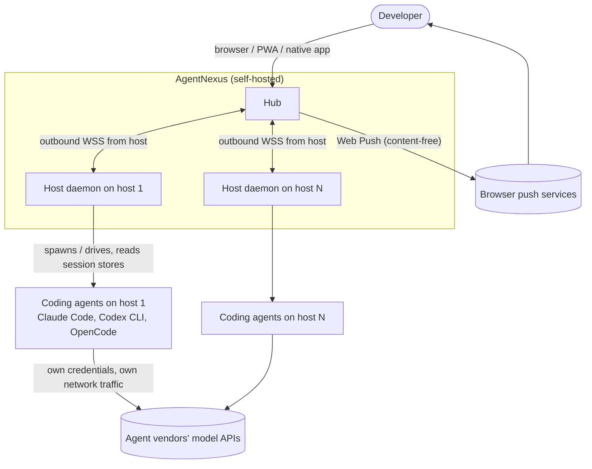
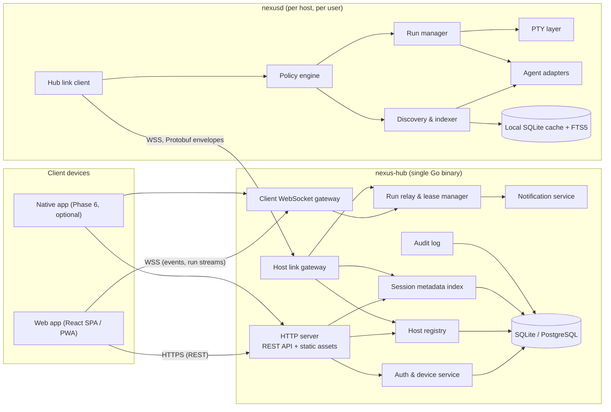
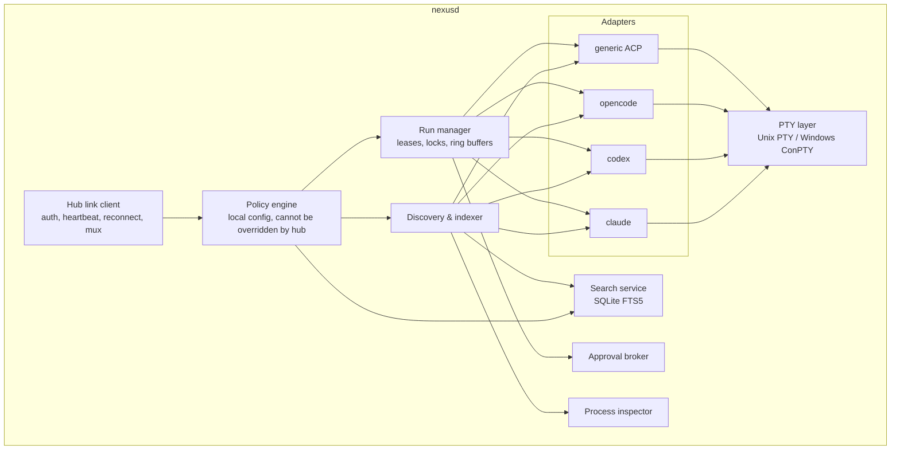
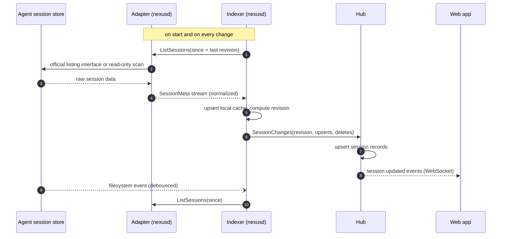
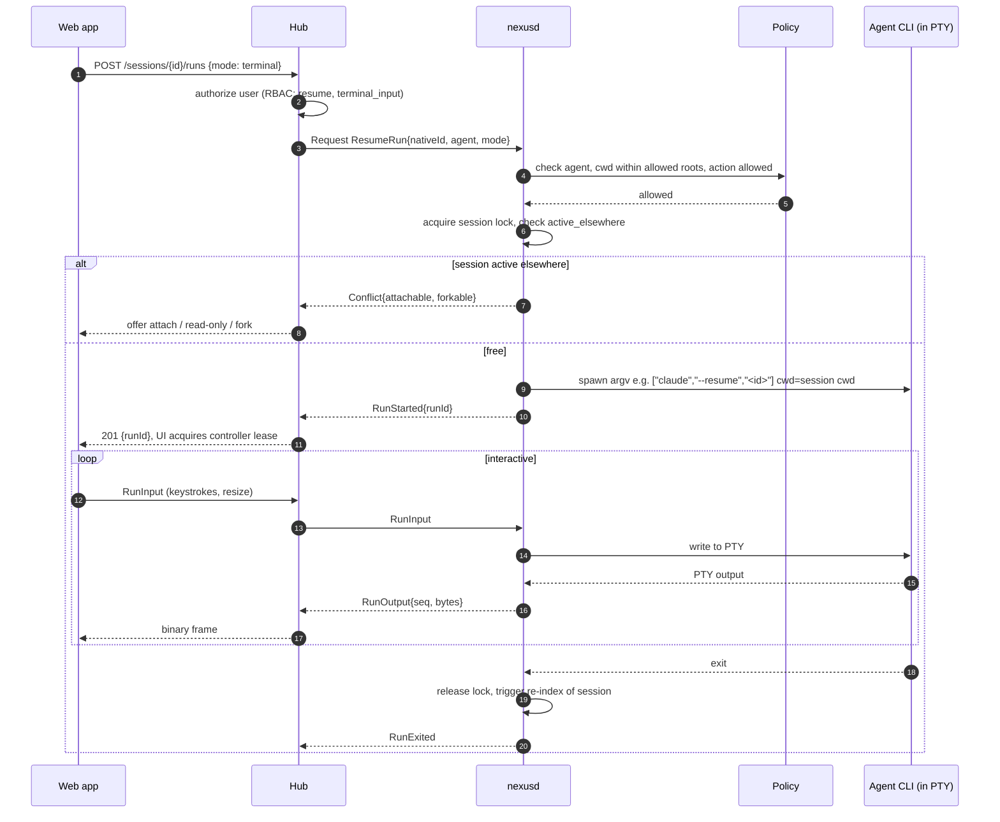
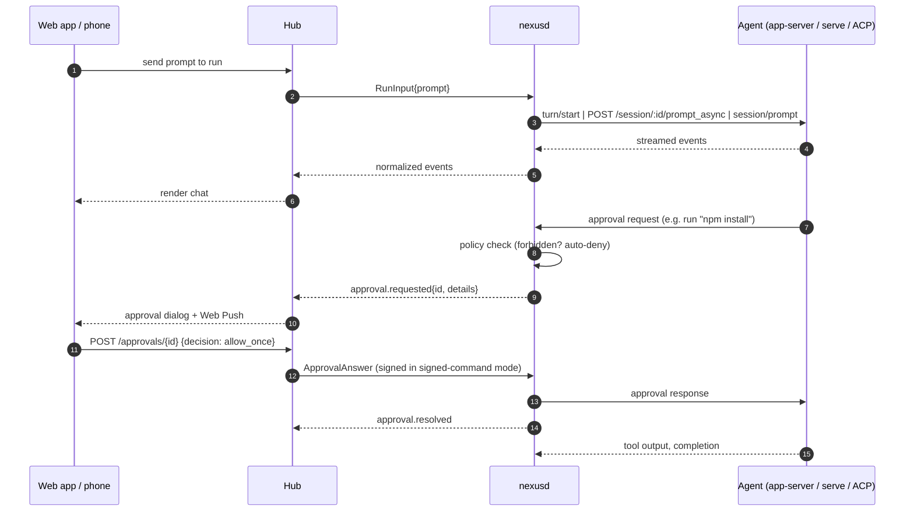
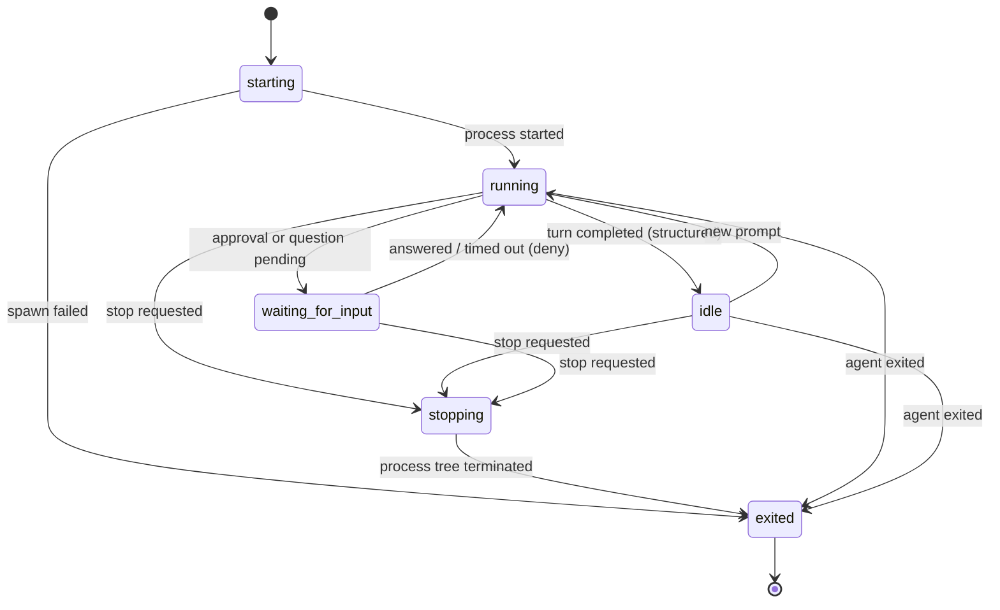
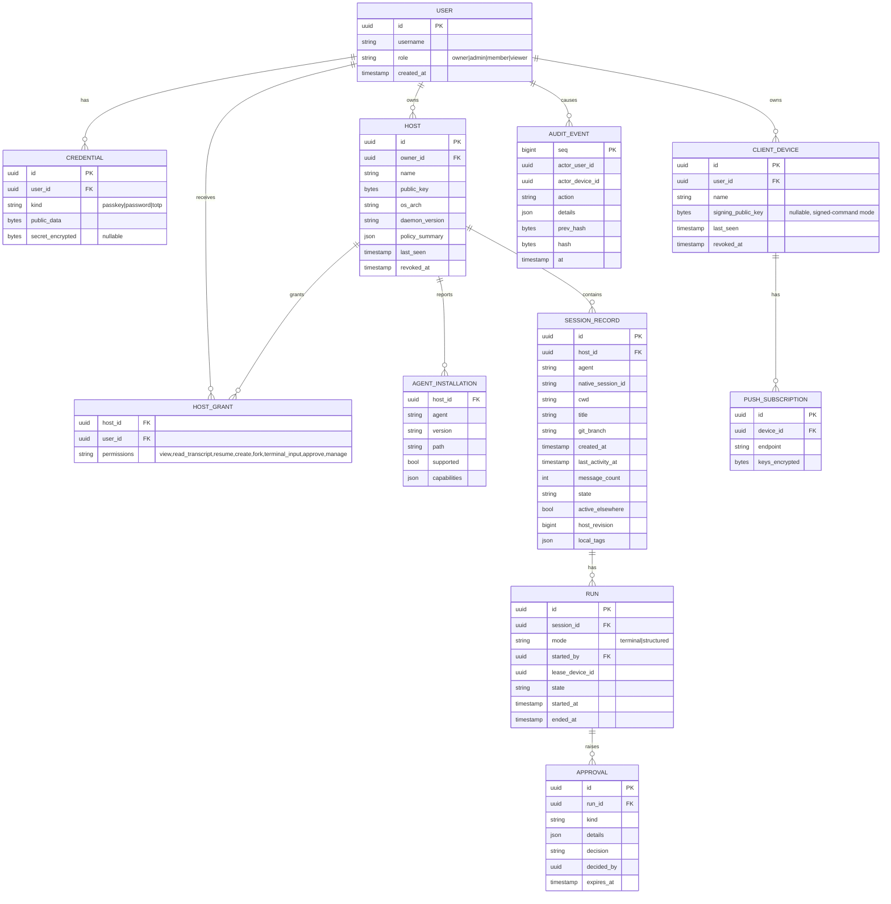
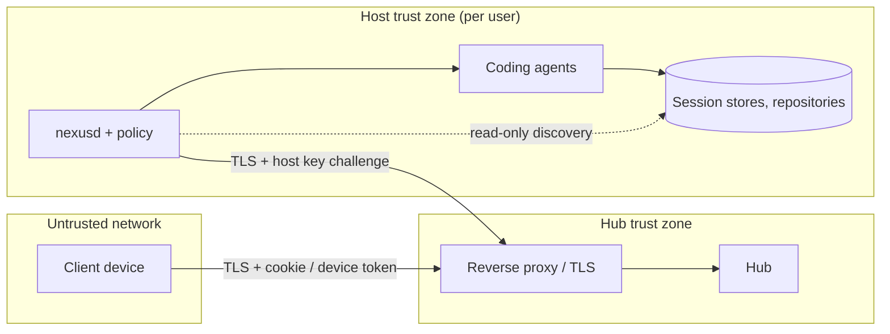
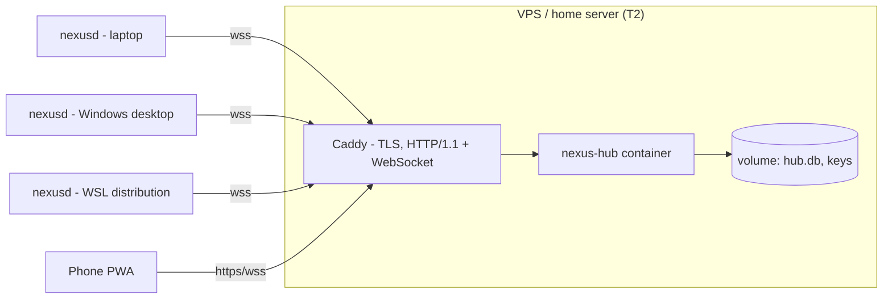

# AgentNexus — System Architecture

This document describes the components of AgentNexus and how they interact. Requirements and decisions referenced here (FR-xx, NFR-xx, ADR-xxx) are defined in [PLAN.md](PLAN.md). Agent-specific behavior is in [AGENT-INTEGRATIONS.md](AGENT-INTEGRATIONS.md); the security design is in [SECURITY.md](SECURITY.md).

## Table of contents

1. [System context](#1-system-context)
2. [Containers](#2-containers)
3. [Hub](#3-hub)
4. [Host daemon (`nexusd`)](#4-host-daemon-nexusd)
5. [Agent adapter model](#5-agent-adapter-model)
6. [Communication](#6-communication)
7. [Key flows](#7-key-flows)
8. [Data model](#8-data-model)
9. [Frontend](#9-frontend)
10. [Native clients](#10-native-clients)
11. [Security architecture overview](#11-security-architecture-overview)
12. [Deployment topologies](#12-deployment-topologies)
13. [Platform specifics](#13-platform-specifics)
14. [Failure handling](#14-failure-handling)
15. [Observability](#15-observability)

---

## 1. System context



AgentNexus never talks to model APIs itself. Coding agents keep using their own credentials and network connections on each host (constraint C2).

## 2. Containers



| Container | Responsibility | Technology (ADR) |
| --- | --- | --- |
| Web app | UI for hosts, sessions, transcripts, terminals, chat, approvals | React + TypeScript (ADR-011) |
| Hub | Auth, device registry, host registry, metadata index, relay, notifications, audit | Go (ADR-002), SQLite/PostgreSQL (ADR-008) |
| Host daemon | Discovery, run management, PTY, adapters, policy enforcement, local search | Go, CGO-free (ADR-002, NFR-09) |

## 3. Hub

### 3.1 Responsibilities

- **Identity:** users, passkeys, password/TOTP fallback, client devices, browser sessions ([SECURITY.md](SECURITY.md#user-authentication)).
- **Host registry:** pairing, host public keys, connection state, reported agent inventory, reported host policy summary (read-only on the hub).
- **Session metadata index:** one record per native session, updated from host change feeds. Content (messages) is not stored by default (principle P2).
- **Run relay:** routes run streams between hosts and clients, assigns sequence numbers, fans out to multiple viewers, enforces the controller lease (FR-25).
- **Request router:** forwards client requests that need host data (transcript pages, search, directory listing) to the host and streams responses back, with per-request timeouts.
- **Notifications:** turns host state events (`waiting_for_input`, `completed`, `failed`) into in-app events and Web Push messages (FR-30, FR-31).
- **Audit:** append-only, hash-chained event log (FR-45).

### 3.2 Internal structure

The hub is a modular monolith: one process, packages with explicit interfaces. A message bus abstraction (in-process channels in v1) decouples the gateways from services so that a later horizontal scale-out (e.g. with PostgreSQL `LISTEN/NOTIFY` or NATS) is possible without rewriting services. Horizontal scaling is not a 1.0 goal (NFR-05 is met by a single instance).

### 3.3 Client API (REST, OpenAPI 3.1)

Representative endpoints (implemented in `internal/hub`; there is no generated
OpenAPI document yet):

| Method & path | Purpose |
| --- | --- |
| `POST /api/v1/auth/passkey/begin`, `/api/v1/auth/passkey/finish` | Passkey login |
| `POST /api/v1/auth/step-up/begin`, `/passkey`, `/password` | Fresh confirmation for sensitive actions |
| `GET /api/v1/hosts` | Hosts with state and agent inventory |
| `POST /api/v1/hosts/pairing-codes` | Create a one-time pairing code |
| `DELETE /api/v1/hosts/{hostId}` | Revoke host |
| `GET /api/v1/sessions?host=&agent=&project=&state=&q=&limit=&offset=` | Paged session records |
| `GET /api/v1/projects?limit=` | Session metadata grouped by host and working directory |
| `GET /api/v1/favorites`, `PUT/DELETE /api/v1/sessions/{sessionId}/favorite` | Per-user pinned sessions |
| `GET /api/v1/sessions/{sessionId}/transcript?offset=&limit=` | Paged transcript (fetched from host) |
| `GET /api/v1/sessions/{sessionId}/export?format=markdown|json` | Full transcript export, bounded at 10,000 messages |
| `GET /api/v1/sessions/{sessionId}/git` | Read-only branch, status and diff from the host |
| `POST /api/v1/sessions/{sessionId}/runs` | Resume (`mode=terminal|structured`, `fork=false|true`) |
| `POST /api/v1/hosts/{hostId}/runs` | Start a new session (`agent`, `cwd`, `mode`) |
| `GET /api/v1/runs` | Active runs visible to the user (dashboard) |
| `POST /api/v1/runs/{runId}/lease` | Acquire/transfer controller lease |
| `POST /api/v1/runs/{runId}/stop` | Stop run |
| WebSocket `approval` message | Answer an approval request through the run lease |
| `GET /api/v1/notifications`, `POST /api/v1/notifications/read` | In-app notification history and read state |
| `GET /api/v1/search?q=` | Federated full-text search |
| `GET /api/v1/devices`, `DELETE /api/v1/devices/{id}` | Device management |
| `GET /api/v1/audit` | Audit log (verified chain) |

`sessionId` is the hub's opaque ID; the tuple `(hostId, agent, nativeSessionId)` is unique.

## 4. Host daemon (`nexusd`)



| Module | Responsibility |
| --- | --- |
| Hub link client | Challenge–response authentication with the host key, heartbeat (default 20 s), reconnect with exponential backoff (1 s → 60 s, full jitter), channel multiplexing, flow control. |
| Policy engine | Loads `nexusd.json` (see [SECURITY.md — Host policy](SECURITY.md#host-policy)); every incoming request is checked before execution. The hub only receives a read-only summary. |
| Discovery & indexer | Runs adapter discovery on start, then a full rescan every 30 seconds; a SHA-256 hash of the normalized snapshot suppresses unchanged uploads. A parser failure reuses the last successful per-agent snapshot instead of deleting sessions. |
| Process inspector | Maps running agent processes to native sessions (agent-specific signals, see [AGENT-INTEGRATIONS.md](AGENT-INTEGRATIONS.md#2-common-adapter-contract)) to set `active_elsewhere`. |
| Run manager | Creates runs (terminal or structured), enforces one active run per native session across all four run maps, keeps a bounded output buffer for replay, and stops the child process on request. Full process-tree guarantees are still a roadmap item. |
| Approval broker | Receives approval requests from structured drivers, applies policy (auto-deny forbidden actions), forwards to hub, enforces timeouts (default 10 min → deny). |
| Search service | Performs a tolerant linear scan over the agents' JSONL/SQLite stores and answers federated search queries. An FTS5 cache is a roadmap item. |
| PTY layer | Cross-platform PTY with resize, UTF-8 handling, signal delivery and process-tree termination (process groups on Unix, Job Objects on Windows). |

### 4.1 Process model

`nexusd` is a single long-lived process per user per host (ADR-012). Every run spawns the agent as a child process (terminal mode: inside a PTY; structured mode: stdio pipes or a loopback HTTP server). Children inherit a **scrubbed environment**: the user's normal login environment plus agent-specific variables, minus AgentNexus secrets. If `nexusd` restarts, structured-mode children are stopped gracefully (their sessions are already persisted natively by the agent); terminal-mode children are also stopped — a later version may hand PTYs to a small supervisor to survive daemon upgrades.

## 5. Agent adapter model

Each adapter implements a **Discovery** interface and a **Control** interface (ADR-004). The contract is specified in [AGENT-INTEGRATIONS.md §2](AGENT-INTEGRATIONS.md#2-common-adapter-contract). Conceptually:

```text
Discovery
  Detect()                     -> installation {path, version, configDirs, supported: bool}
  ListSessions(since)          -> stream of SessionMeta
  ReadTranscript(id, cursor)   -> page of NormalizedMessage
  LiveState(id)                -> {state, activeElsewhere, attachable}
  WatchTargets()               -> paths/intervals for incremental indexing

Control
  Capabilities()               -> {terminal, structured, fork, attach, approvals, interrupt}
  BuildTerminalCommand(action) -> {argv, cwd, env}     action = resume | new | fork | attach
  StartStructured(action)      -> StructuredRun (event stream + input + approvals + interrupt)
```

Structured drivers translate agent-specific events into the **normalized event model**:

| Event | Fields (abbreviated) |
| --- | --- |
| `message.delta` / `message.completed` | role, text/markdown, message ID |
| `reasoning.delta` | summary text (only if the agent exposes it) |
| `tool.started` / `tool.output` / `tool.completed` | tool name, input (command, path), output (truncated, paged), status |
| `file.changed` | path, unified diff |
| `plan.updated` | plan items with status |
| `approval.requested` / `approval.resolved` | approval ID, kind (command, file, network, other), details, options |
| `usage.updated` | tokens, cost estimate (if provided) |
| `run.state` | `starting`, `running`, `waiting_for_input`, `idle`, `stopping`, `exited` + exit info |

## 6. Communication

### 6.1 Host link

> **Implementation note (0.1.x):** the same WebSocket, channel and replay semantics are used, but the envelope is JSON (`internal/protocol`) instead of Protobuf. See [ADR-014](PLAN.md#adr-014--json-host-link-and-dependency-light-web-client-for-01x).

- **Transport:** `wss://<hub>/v1/host/connect`. TLS 1.3 preferred, TLS 1.2 minimum. Works behind reverse proxies with WebSocket upgrade support (ADR-006).
- **Framing:** each WebSocket binary message carries one Protobuf `Envelope`:

```protobuf
// Illustrative schema — final version in proto/agentnexus/v1/link.proto
message Envelope {
  uint32 channel   = 1;  // 0 = control channel, >0 = run/request channels
  uint64 seq       = 2;  // per-channel sequence number for replay/ack
  oneof body {
    Hello            hello = 10;
    AuthChallenge    auth_challenge = 11;
    AuthResponse     auth_response = 12;
    InventoryReport  inventory = 13;
    SessionChanges   session_changes = 14;
    Request          request = 15;   // hub -> host (resume, transcript page, search, ...)
    Response         response = 16;
    RunOutput        run_output = 17; // PTY bytes or normalized events
    RunInput         run_input = 18;  // keystrokes, resize, prompts, approval answers
    Credit           credit = 19;     // flow control window update
    Ack              ack = 20;
    Error            error = 21;
  }
}
```

- **Version negotiation:** `Hello` carries `protocol_version` (major.minor) and a capability list; the hub accepts majors it supports and refuses others with an upgrade hint (NFR-12).
- **Flow control:** credit-based per channel (initial window 256 KiB). Slow viewers never block the host: the hub keeps a bounded per-viewer queue; a viewer that overflows is resynchronized from the host ring buffer (terminal mode) or from the last acknowledged event sequence (structured mode).
- **Replay:** run output carries per-run sequence numbers; on reconnect the hub requests replay from the last acknowledged sequence, bounded by the ring buffer.

### 6.2 Client connection

- REST for queries and commands; one WebSocket per client (`wss://<hub>/v1/client/ws`) for: session record updates, run streams (subscribe/unsubscribe per run), approval events, notifications.
- Terminal data uses binary frames; everything else JSON.
- Browser authentication via `Secure; HttpOnly; SameSite=Strict` cookie; the WebSocket handshake validates the `Origin` header and a per-session CSRF token (see [SECURITY.md](SECURITY.md#web-security-controls)).

### 6.3 Agent-side communication (inside the host)

| Mode | Channel | Used for |
| --- | --- | --- |
| Terminal | PTY master ↔ agent TUI | All agents |
| Structured — Codex | stdio JSON-RPC (`codex app-server`, JSONL) | Codex CLI |
| Structured — OpenCode | HTTP + SSE on `127.0.0.1:<random port>` with random basic-auth password (`opencode serve`) | OpenCode |
| Structured — ACP | stdio JSON-RPC (ACP) | Claude Code (via `claude-agent-acp`), Gemini CLI, other ACP agents |
| Discovery | Read-only filesystem access, short-lived CLI calls (`opencode session list --format json`, `claude agents --json`) | All agents |

## 7. Key flows

Host pairing is described in [SECURITY.md — Host pairing](SECURITY.md#host-pairing).

### 7.1 Discovery of existing sessions



### 7.2 Native resume in terminal mode



### 7.3 Structured mode with remote approval



### 7.4 Run state machine



## 8. Data model

### 8.1 Hub database



### 8.2 Host-local cache (`nexusd`)

| Table | Content |
| --- | --- |
| `session_meta` | Normalized metadata per native session + source fingerprint (path, size, mtime, hash of header) for change detection |
| `transcript_fts` | FTS5 virtual table with message text (optional, can be disabled in policy) |
| `runs` | Local run history for diagnostics |
| `audit_local` | Local append-only audit of commands received from the hub |

The cache is disposable: deleting it triggers a full re-index from native stores.

## 9. Frontend

> **Implementation note (0.1.x):** the embedded client is dependency-free ES modules plus vendored xterm.js and has no build step. The route and state model below is the target; a React migration remains an option (ADR-014).

- **Routes:** `/` (overview), `/hosts`, `/sessions` (global list), `/sessions/:id` (detail + transcript + export), `/runs` (live multi-run dashboard), `/runs/:id` (terminal or chat), `/search`, `/devices`, `/users`, `/audit`.
- **State:** server state via TanStack Query; live updates from the client WebSocket patch the query cache; no global client store beyond UI preferences.
- **Terminal view:** xterm.js with fit and web-links add-ons; WebGL renderer where available; mobile accessory key bar (Esc, Tab, Ctrl, arrows); OSC 52 clipboard writes disabled by default (see [SECURITY.md](SECURITY.md#terminal-and-content-safety)).
- **Chat view:** virtualized message list, markdown rendering with sanitization, collapsible tool cards, side-by-side/unified diff, approval sheet pinned to the bottom on mobile.
- **PWA:** web app manifest, service worker caching only the static shell (no API responses), Web Push handling.
- **Accessibility and i18n:** see NFR-10, NFR-11.

## 10. Native clients

"Native clients" covers two different things:

1. **Native host clients (mandatory, Phase 1):** `nexusd` builds for Windows, Linux and macOS, installed as per-user services, with `nexusd pair`, `nexusd status`, `nexusd doctor`, `nexusd service install|uninstall`. On Windows and macOS an optional tray/menu-bar companion (later) shows connection status and pending local confirmations.
2. **Native end-user apps (optional, Phase 6):** desktop and mobile apps wrapping the web UI (Tauri 2 is the current candidate), adding OS-keystore protected device keys for signed-command mode, native notifications and deep links. They use exactly the same client API as the web app.

## 11. Security architecture overview

The full design is in [SECURITY.md](SECURITY.md). Architecturally relevant points:



- Trust boundaries: client ↔ hub (user authentication), hub ↔ host (host authentication + host-side policy), daemon ↔ agent (local process boundary; agents keep their own permission systems).
- Defense in depth: hub RBAC **and** host policy must both allow an action; in signed-command mode the host additionally verifies the client device's signature.

## 12. Deployment topologies

| Topology | Description | Recommended for |
| --- | --- | --- |
| **T1 — Private network** | Hub on a home server/NAS; hosts and clients reach it over LAN or a VPN (WireGuard, Tailscale, …). Hub not exposed to the internet. | Default recommendation |
| **T2 — Public hub behind reverse proxy** | Hub in a container on a VPS behind Caddy/Traefik/nginx with automatic TLS; passkeys required; optional IP allow-listing. | Access from anywhere without VPN |
| **T3 — Local only** | Hub and daemon on the same machine, hub bound to `127.0.0.1`. | Trying it out, single machine |



## 13. Platform specifics

| Topic | Linux | macOS | Windows |
| --- | --- | --- | --- |
| Service | `systemd --user` unit; `loginctl enable-linger` to run without login | LaunchAgent in `~/Library/LaunchAgents` with `RunAtLoad`/`KeepAlive` | Per-user Task Scheduler task at logon, least privilege, restart on failure; no boot-time task by design |
| PTY | Unix PTY (`creack/pty`) | Unix PTY | ConPTY (Windows 10 1809+) |
| Process stop | `SIGINT` via PTY, then kill after 1.5 s | Same | `CTRL_C` via ConPTY, then kill; process-tree termination is best effort |
| Executable resolution | `PATH` | `PATH` (note: launchd has a minimal `PATH`; daemon loads the user's login shell environment once at start) | `PATH` + `PATHEXT`; npm-installed CLIs are `.cmd` shims that must be launched correctly |
| Secret storage for host key | file `0600` (OS keystore is a roadmap item) | file `0600` (Keychain is a roadmap item) | file `0600` (DPAPI is a roadmap item) |
| Config/data dirs | XDG (`~/.config/agentnexus`, `~/.local/share/agentnexus`) | `~/Library/Application Support/AgentNexus` | `%APPDATA%\AgentNexus`, `%LOCALAPPDATA%\AgentNexus` |
| Special issues | Headless servers without a user session (linger) | TCC privacy prompts for `~/Documents`, `~/Desktop`, iCloud Drive (risk R-06) | Path casing, long paths, CRLF; ConPTY rendering quirks (risk R-05) |
| WSL | — | — | Agents installed inside WSL keep their sessions inside the distribution's filesystem; run a separate `nexusd` inside each distribution (appears as its own host). Windows-side `nexusd` does not read WSL session stores. |

## 14. Failure handling

| Failure | Behavior |
| --- | --- |
| Hub unreachable from host | Runs continue locally; output buffered in ring buffer; changes queued (bounded) and sent after reconnect; index resynchronized by revision. |
| Client disconnect | Run continues; controller lease released after grace period (default 60 s) unless reclaimed by the same device; replay on reconnect. |
| Daemon crash/restart | Native sessions are safe (agents persist them); runs are marked `exited (daemon restart)`; user can resume again. |
| Agent update breaks adapter | Adapter reports `supported=false` for structured mode; terminal mode remains; UI shows a warning (NFR-08). |
| Corrupt/unknown session file | Record indexed with partial metadata and `parse_warning`; never blocks the rest of the index. |
| Approval timeout | Default deny; agent continues per its own semantics; event audited. |

## 15. Observability

- Structured JSON logs (`log/slog`), correlation IDs `request_id`, `host_id`, `run_id`; conversation content and secrets are never logged (NFR-13).
- Health: `GET /healthz` (liveness), `GET /readyz` (DB reachable) on the hub; `nexusd status` locally.
- Metrics (optional, `/metrics`, Prometheus format, disabled by default and bound to localhost or protected): connected hosts, active runs, relay throughput, discovery duration, adapter errors by agent and version.
