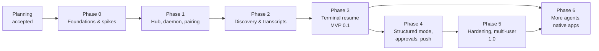
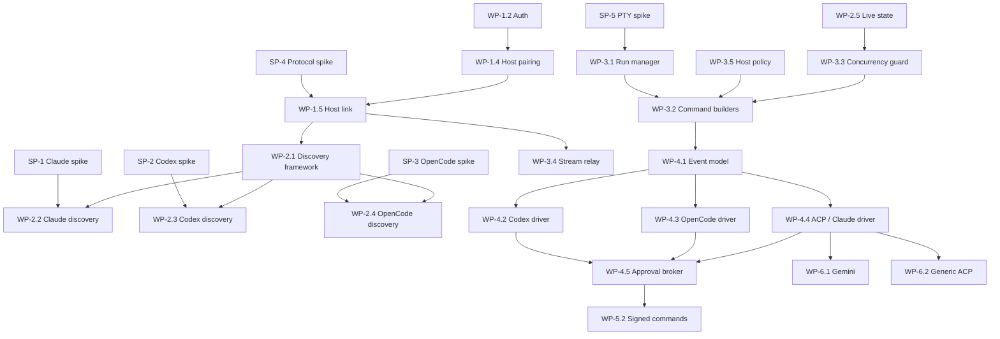

# AgentNexus — Roadmap

Development phases, priorities, milestones, dependencies and acceptance criteria. Work packages (WP-x.y), requirements (FR/NFR) and decisions (ADR) are defined in [PLAN.md](PLAN.md); this document does not repeat their descriptions.

- **Planning rule:** the planning phase (this documentation) must be accepted before Phase 0 starts. Each phase starts only when the previous phase's milestone is reached, except where noted as parallelizable.
- **No calendar dates** are committed yet; effort is given as rough relative size (S ≈ 1–2 weeks, M ≈ 3–5 weeks, L ≈ 6–10 weeks for one full-time developer) and will be re-estimated after Phase 0.

## Overview

| Phase | Goal | Size | Milestone | Release |
| --- | --- | --- | --- | --- |
| [0](#phase-0--foundations-and-technical-spikes) | Validate all critical assumptions; scaffolding and CI | M | **M0** Spikes done, ADRs final | — |
| [1](#phase-1--hub-host-daemon-and-pairing) | Secure hub, paired hosts on all three OSes | L | **M1** Hosts online | 0.0.x (internal) |
| [2](#phase-2--session-discovery-and-transcript-viewer) | See all existing sessions and transcripts | L | **M2** Discovery complete | 0.0.x (internal) |
| [3](#phase-3--native-resume-in-terminal-mode-mvp) | Natively resume sessions from the browser | L | **M3** MVP | **0.1.0** |
| [4](#phase-4--structured-mode-approvals-and-notifications) | Chat UI, approvals, push, mobile | L | **M4** Structured mode | 0.2.0 – 0.4.0 |
| [5](#phase-5--hardening-multi-user-and-10) | Production readiness and security | L | **M5** 1.0 | **1.0.0** |
| [6](#phase-6--additional-agents-and-native-apps) | More agents, native apps | M per item | **M6.x** per item | 1.x |

## Implementation status

The repository now contains a runnable alpha implementation. There is no
official version and no published release. The criteria below track engineering
goals; they are not release gates. Publication is a separate maintainer decision.

### Alpha verification (2026-11-12)

- Go unit and integration tests pass on Linux, macOS and Windows in CI,
  including `go test -race` on Linux; `go vet`, `gofmt` and staticcheck are
  clean. Statement coverage is 68.8% in `internal/hub` and 66.7% in
  `internal/host`. Coverage includes HTTP/WebSocket/RBAC/grant tests, a scripted
  fake host that answers transcript, search, git, export and run requests, a
  fake-hub host link with terminal runs, a re-executed fake OpenCode server,
  Codex app-server and ACP agent for structured starts, policy rejection, Codex
  JSON-RPC, Gemini search, a grandchild process-tree test and ACP session
  controls.
- 44 JavaScript unit tests pass; the browser smoke test and the axe-core scan
  pass on desktop and mobile in English and German. A pinned-clock pixel diff
  covers six stable demo views; the manual/nightly job runs on a Windows
  runner with a wider tolerance.
- Store benchmarks at 10,000 sessions: full snapshot replacement 1.42 s,
  listing 500 sessions 140 ms, project aggregation 197 ms.
- Host FTS5 index with 10,000 synthetic sessions: seeding 188 ms and search
  p95 36 ms (budget 2 s). This measures the index itself; a full adapter-driven
  initial index of 10,000 real sessions is not measured.
- Online backup and restore preserve users and session metadata.
- Screenshots are generated from `cmd/nexus-demo` fixtures, not real sessions.
- **Still unproven:** physical three-host operation, real Linux/macOS agent
  sessions, Docker/Portainer runtime deployment, update/rollback against a real
  release feed, a real Claude ACP session, host-side device-signature verification,
  PostgreSQL. Visual baselines exist only for Windows 11.

| Phase | Status | Implemented | Notable gaps |
| --- | --- | --- | --- |
| 0 | 🟡 mostly | Go module, CI matrix, embedded web client, host-link and PTY prototypes, synthetic adapter fixtures | SP-1 to SP-5 reports in docs/spikes/; per-OS real-agent matrix |
| 1 | 🟡 core | Setup, WebAuthn passkeys, Argon2id + optional TOTP, sessions, device revocation, Ed25519 pairing with SAS confirmation, five-minute step-up confirmation for sensitive actions, outbound link, reconnect, agent detection, per-user services (systemd/launchd/Task Scheduler), `doctor` | Windows Server 2025 not available for testing; no NSSM option |
| 2 | 🟡 core | Claude/Codex/OpenCode discovery, paged transcripts, federated search (including Gemini full-text) with a host-local FTS5 cache, index progress in the UI, `nexusd index rebuild`, best-effort native-process detection, fail-soft parsers | Adapter-driven 10k-session initial-index measurement, per-version fixture matrix |
| 3 | ✅ MVP | PTY/ConPTY terminal resume, new session, per-agent command builders, controller lease, stop with process-tree termination, host policy, audit log, Docker/compose | Full test matrix per agent and OS, WSL test |
| 4 | ✅ partial | OpenCode 2.2.x and Codex structured modes (text, reasoning, tool cards, interrupt, live model/reasoning/agent selection, bounded attachments), native OpenCode/Codex/ACP forks, session parent/fork tree, generic ACP adapters (Claude Code via `claude-agent-acp`), approval broker with timeout, Web Push and an in-app notification inbox with host/agent filters, transcript export (Markdown/JSON), projects with cross-host repository grouping, favorites, session tabs, command palette, control room, two-pane split workspace, review-grade unified/side-by-side diffs, searchable model picker, capability-negotiated session delta sync, buffered reconnect replay, read-only Git context panel, redesigned chat/composer, PWA manifest/service worker/icons, mobile layout review, automated axe-core WCAG scan | Claude ACP path not exercised against a real Claude session; ACP controls are fake-tested only; real OpenCode model turn not run |
| 5 | 🟡 partial | Owner/admin/member/viewer roles, per-host grants, user management, hash-chained audit, rate limits, security headers, GoReleaser/cosign/SBOM pipeline, multi-arch GHCR image, Portainer stack; tasks with dependencies and delegation; host health/detail; diagnostics and redacted export; run limits; run error codes; opt-in device-signed commands with replay protection | PostgreSQL, actual signing credentials, host-side device command verification |
| 6 | 🟡 partial | Best-effort Gemini discovery/resume; read-only git status/diff; generic ACP agent adapters | Native apps |

### NFR-06: discovery watcher (2026-11-12)

The daemon no longer walks every session file on the two-second poll. It stats
directory mtimes, the 200 most recently modified session files, entry counts of
the 10 hottest and 10 newest directories, and SQLite database/WAL files; a
full scan runs every 30 seconds as a safety net. Entry counts make new files
reliable even when Windows updates a directory timestamp late.

Measured with `go test ./internal/host -run '^$' -bench 'StoreWatcher|LegacyWalk' -benchtime=10x`
on 10,000 synthetic session files (Windows 11, AMD EPYC 7543):

| Operation | Result |
| --- | --- |
| Fast poll (steady state) | 8.6 ms/op |
| Full safety scan | 48.1 ms/op |
| Previous full walk every 2 s | 34.8 ms/op |
| New file detected | 19 ms |
| Changed hot file detected | 3 ms |

The fast poll costs about 0.43 % of one core at a two-second cadence; the old
walk cost about 1.7 %. Directory timestamp updates can lag on Windows right
after a bulk import, so one poll may fall back to a full scan; steady state is
measured after that. Cold files (outside the newest 200) are detected by the
30-second full scan. Adapters without a watch path still rely on the periodic
delta refresh.

### P0b: multi-host simulation (2026-11-12)

A deterministic test starts three fake hosts with six sessions, launches three
parallel structured runs, disconnects one host and verifies that only its run
fails, then creates a second server on the same store to verify session and run
metadata survive a hub restart. This is explicitly a simulation; the real
physical multi-host operation is not evidenced by this simulation (see
[VERIFICATION.md](VERIFICATION.md)).

### P0c: real-agent compatibility (2026-11-12)

Codex CLI 0.156.1 and OpenCode 2.2.7 are installed. The Codex app-server schema
was generated and `thread/fork`/`thread/resume` are present; the structured
driver is fake-agent tested. OpenCode 2.2.7 was inspected against its live
SQLite schema and `/openapi.json`: session create, prompt, SSE, permission,
interrupt and native fork paths are implemented, and the tested structured band
is now `>= 2.2.0 < 3.0.0`. No paid model turn was sent; the fork contract was
exercised only up to OpenCode's documented "cannot fork empty session" response.
Claude Code and Gemini CLI are not installed.

### P0e: task orchestration (2026-11-12)

Tasks are persisted per user with cycle-checked dependencies and a closed status
set. Delegation starts a native structured session and delivers the prompt
through the existing durable queue; run and approval events update the task, and
hub restart reconciles orphaned tasks. Tested with a fake host for start, prompt
delivery, completion and dependency blocking. No agent pipeline or automatic
fan-out scheduler is implemented.

### P0f: operations and diagnostics (2026-11-12)

Added explainable host health (`healthy`, `degraded`, `offline`, `pending`,
`disabled`), host detail pages, per-user host favorites, run concurrency limits,
run error classification, admin diagnostics with a step-up redacted export,
bulk device revocation, per-connection browser WebSocket rate limits,
session relationship/usage views and fan-out changed-file comparison.

### P0d: security and stability tests (2026-11-12)

Covered: hub/host restart metadata, host disconnect isolation, concurrent
approvals, queue claims, SSRF blocking, encrypted secrets, token revocation,
request-ID sanitization, per-host grants, process-tree termination, update
refusal and rollback state. Race tests run in CI. Real network partition chaos
and PostgreSQL integration are outside this test record.

### P0e: client/device-signed commands (2026-11-13)

Device command signing is implemented for native clients. A device can register
an Ed25519 or P-256 public key with step-up; prompts, approvals, terminal input,
interrupts, run starts, prompt-queue writes, task delegation, fan-out and run
stops are then rejected unless the canonical request carries a valid signature,
timestamp and nonce. The prompt options (model, agent mode, attachments) are
part of the signed payload. The hub keeps a per-device nonce window and tests
replay, unsigned-write, Ed25519 and P-256/P1363 cases. The browser UI remains
cookie-authenticated because hub-delivered JavaScript cannot protect a key
against a compromised hub; see [DEVICE-SIGNING.md](DEVICE-SIGNING.md).
`--require-signed-commands` enforces signatures for every device. This is
hub-side verification: it protects against stolen cookies and replayed writes,
not against a compromised hub. Host-side rejection of hub-forged commands
remains open.

### P0a: installer/update safety (2026-11-12)

Both installers require the artifact SHA-256, execute a version check, read the
daemon's fresh runtime snapshot and refuse to replace it while runs are active.
`-Force`/`--force` requires typing `FORCE`; service-install failure restores
`nexusd.previous`. Unit tests cover active-run refusal and stale snapshots.

### B9: terminal client (2026-11-12)

`cmd/nexus` provides login (device pairing token or password/TOTP), session
listing, WebSocket attach with controller lease and approval delivery. The
device session is revocable and stored mode 0600. CI cross-compiles it for
Windows, Linux and macOS. Login/sessions/logout were exercised against a real
local hub; attach and approve share the browser protocol but were not exercised
against a live host. Input is line-oriented, not a raw PTY.

### B8: read-only MCP endpoint (2026-11-12)

`POST /mcp` implements stateless JSON-RPC MCP initialization, tool listing and
tool calls with scoped read-only bearer tokens. Tools cover hosts, sessions,
federated transcript search, bounded transcript pages and Git status. Tokens
are created only after step-up, stored as SHA-256 hashes, shown once, revocable
and rate-limited to 120 requests/minute. Every call is audited. There is no
start/stop/prompt/approval/write tool and per-host grants are enforced as the
token owner. API tests cover auth, revocation, initialization, tools and error
results; a real third-party MCP client was not available.

### B11: keyboard shortcuts (2026-11-12)

A `?` dialog lists every implemented shortcut, grouped by navigation, tabs,
composer, approvals and panels. `g` sequences navigate to the main sections,
`Alt+1…9` switches tabs, `Alt+W` closes the active tab, `Ctrl/⌘+I` toggles the
details panel, `a`/`d` answer a visible approval, `x` interrupts and Escape
closes dialogs/panels. The dialog is focus-managed by the shared modal and is
translated in English and German. No separate backend state is involved.

### B10: project activity (2026-11-12)

The sessions page exposes a 90-day heatmap for the active project (or for a
repository identity across hosts). A server-side query aggregates sessions,
runs, agents and hosts by UTC day; clicking a cell opens the session list with
the exact day range. No transcript content is involved. Verified by an API test
with synthetic sessions and runs.

### B7: voice input (2026-11-12)

The composer exposes a microphone button only when the browser implements the
Web Speech API. Dictation uses `de-DE` or `en-US` from the UI language, appends
interim results to the existing draft, keeps the text editable and never sends
automatically. Browsers without the API hide the control. No audio or
transcript is stored by the hub. Manual browser verification only; the test
environment cannot exercise a real microphone.

### B6: external notification channels (2026-11-12)

Web Push can be complemented by ntfy, Gotify, Telegram, Discord, Slack and
generic webhook channels. Channel configuration is sealed with the hub secret
box and never returned to the browser. Delivery uses the same user and host
event preferences as push, contains only the generic title/body/link, has an
eight-second timeout, one bounded retry for transient failures and a test
action. URLs are validated at creation and every connection is checked at the
socket layer; loopback, private, link-local and internal targets are blocked by
default, which also means self-hosted ntfy/Gotify need a public hostname or a
reverse proxy. Fake HTTP tests cover SSRF rejection, encryption at rest,
redaction, delivery and the test action; real ntfy/Telegram/etc. services were
not contacted.

### B5: prompt templates (2026-11-12)

Prompt templates are stored in SQLite, scoped to the owner and optionally shared
by an admin. The composer lists and searches them, inserts a rendered body at
the cursor, and expands `/tpl <name>` on send. `{{branch}}`, `{{project}}` and
`{{selection}}` are resolved from the current session and selection; unknown
variables are left untouched. CRUD, ownership and sharing are covered by API
tests. Slash expansion is checked in the browser during the final manual pass.

### B1: multi-agent fan-out (2026-11-12)

The Fan-out page starts one new structured native session per selected host and
working directory and enqueues the same prompt for each run. Runs are created
independently; a failure on one host is reported without stopping the others.
Every target is checked for create permission, host state and duplicate
host/worktree pairs before anything starts. Prompt delivery reuses the durable
queue, so each run receives it only after an idle transition and no prompt is
executed twice. The result grid links to each chat and changes view. Limit: eight
targets per fan-out, structured mode only; a shared worktree on one host is
rejected rather than coordinated.

### B3: usage metadata (2026-11-12)

Structured runs report token usage to the hub when the agent runtime exposes
it: Codex `thread/tokenUsage/updated`, OpenCode `session.usage.recorded`, and
ACP prompt responses or `usage_update` notifications. The hub stores only
numeric metadata and an optional USD cost, never prompt or transcript text.
The Usage page aggregates by run, session, agent, host, project and day with
7/30/90/365-day filters. Values the runtime does not report are counted as
unavailable; there is no token estimation, no invented price table and no
currency conversion. Historical sessions without a structured run have no
usage row, and OpenCode 2.x structured mode remains disabled by its version
band, so its live usage path is not exercised here. Verified by API tests with
synthetic usage; real Codex/ACP usage output was not available in this
environment.

### B2: persistent prompt queue (2026-11-12)

Structured runs have a per-run SQLite prompt queue. Items can be scheduled,
reordered, edited, removed and paused; the hub delivers at most one prompt per
run and only after the host reports a transition to idle. Every delivery
re-checks the controller lease, session resume permission and host state.
Delivery is claimed atomically, and an item left in `sending` by a hub crash is
marked failed rather than resent, so a reconnect cannot execute a prompt twice.
The chat composer exposes the queue with a clock button and an inline panel.
Queues are only available for structured runs. Verified by store and fake-host
API tests; scheduled delivery is polled every two seconds.

### A11: structured fork (2026-11-12)

Codex `app-server` `thread/fork` is implemented and tested against a scripted
app-server and the generated 0.156.1 schema. The hub creates a separate session
row for the returned thread, rebinds the run to it and leaves the source
session untouched. ACP fork is gated on the unstable `session/fork`
capability; the fake adapter test covers it. OpenCode's tested v2 API has no
documented non-interactive fork, so structured fork is not offered for OpenCode.
The UI exposes a structured fork button for Codex. Real Codex fork was not run
against a live account in this environment; terminal fork remains available.

### Earlier UI and workflow pass

- Chat now renders Markdown/GFM, highlighted code, tables, collapsible tool
  cards with human summaries, tool output/diffs, reasoning and approvals; native
  history is paged and streaming is throttled.
- New shell: projects and pinned sessions in the rail, session tabs, resizable
  context panel, notification inbox, command palette and mobile bottom nav.
- Read-only Git branch/status/diff is available from a session or chat context.
- Windows path normalization and branch enrichment make projects consistent
  across OpenCode, Codex and Claude stores.
- The design rationale and remaining gaps are documented in
  [UI-DESIGN.md](UI-DESIGN.md).

### Honest limitations of the current build

- The browser client is dependency-free ES modules plus vendored xterm.js, not
  the React app described in ADR-011. See ADR-014.
- The host link uses JSON envelopes, not Protobuf. See ADR-014.
- Passkeys and password + optional TOTP are implemented. TOTP secrets and the
  VAPID private key are encrypted at rest with AES-256-GCM under `secret.key`;
  legacy plaintext values are migrated on startup.
- Structured mode is implemented for OpenCode and Codex, and for any agent
  with an ACP adapter configured (`nexusd acp`; `claude-agent-acp` and
  `claude-code-acp` are detected automatically). Approvals are forwarded for OpenCode permission requests,
  Codex app-server requests and ACP permission requests, and default-deny
  after ten minutes. Web Push requires HTTPS/localhost and browser permission.
  Device (QR) pairing uses a bearer link; SAS comparison is implemented for
  host pairing only.
- Session state is derived from AgentNexus runs and cached metadata; sessions
  opened outside AgentNexus are detected on a best-effort basis and can be
  missed when a wrapper hides the agent name or native ID.
- Transcript fallback parsers are tolerant but not yet covered by a per-version
  fixture matrix.
- The Windows Task Scheduler service was tested on Windows 11 (10.0.26100) with
  a non-elevated user. Windows Server 2025 uses the same schema but was not
  available for testing. The Docker image build and GHCR workflow could not be
  run locally because no Docker daemon was available on the development host;
  CI builds it.
- Host policy includes `allowed_agents` for new and resumed runs in terminal,
  OpenCode, Codex and ACP modes. Regression tests cover the policy helper; a
  malicious hub cannot bypass it because the check runs on the host.
- The browser client has dark, light and system themes persisted in
  `user_settings` on the hub. A Playwright smoke test covers login, themes,
  navigation, projects, command palette, notifications, sidebar collapse and a
  390 px mobile viewport in CI; Markdown/tool formatting has Node unit tests.
- Screenshots in `docs/screenshots/` are generated from the synthetic
  `cmd/nexus-demo` hosts and sessions, including tool cards, diffs and a Git
  review. They show the real UI and renderer, but no real user, host, project or
  transcript data.

## Priorities

1. **P1 — Native resume of existing sessions (terminal mode)** for Claude Code, Codex CLI and OpenCode on Windows, Linux and macOS — the core value; delivered with MVP 0.1.
2. **P2 — Security baseline** (passkeys, pairing, host policy, audit) — delivered *before or with* any remote-control capability, never after.
3. **P3 — Discovery and overview** across hosts.
4. **P4 — Structured mode, approvals and push** for mobile use.
5. **P5 — Hardening and multi-user.**
6. **P6 — Additional agents and native apps.**

## Dependencies

External dependencies: availability and stability of the agents' interfaces listed in [PLAN.md §13](PLAN.md#13-verification-status-of-external-dependencies) and [AGENT-INTEGRATIONS.md §10](AGENT-INTEGRATIONS.md#10-verification-backlog).

---

## Phase 0 — Foundations and technical spikes

**Goal:** remove the largest technical uncertainties before building features.
**Work packages:** WP-0.1 … WP-0.7. Spikes SP-1 … SP-5 can run in parallel.

**Deliverables:** spike reports (in `docs/spikes/`), recorded fixtures per agent version, generated protocol schemas, PTY library decision, repository scaffolding, CI pipeline, updated ADRs and verification status.

**Acceptance criteria (M0):**

- [ ] For each of Claude Code, Codex CLI and OpenCode, on Linux, macOS **and** Windows: a spike program lists at least 95 % of the existing sessions in a prepared test store (compared with the agent's own list command/picker) with correct native ID and working directory.
- [ ] For each of the three agents on each OS: a session resumed through the spike PTY wrapper continues the same native session; afterwards the agent's own CLI (`claude --resume`, `codex resume`, `opencode --session`) shows the new turns.
- [ ] Structured-mode handshake demonstrated for Codex app-server (`thread/list`, `thread/resume`, `turn/start`, one approval), OpenCode server (list, prompt, one permission) and one ACP agent (`initialize`, `session/new` or `session/load`, `session/prompt`).
- [ ] Host-link prototype passes through Caddy, Traefik and nginx with TLS termination; terminal echo p95 ≤ 150 ms on LAN (NFR-03).
- [ ] Every ❓ item in [AGENT-INTEGRATIONS.md §10](AGENT-INTEGRATIONS.md#10-verification-backlog) is resolved to ✅/⚠️ or documented as a blocker with a fallback.
- [ ] CI builds empty `nexus-hub` and `nexusd` skeletons for all six targets; lint, license check and `govulncheck` run on every PR.
- [ ] Threat model reviewed; ADRs marked provisional are confirmed or replaced.

## Phase 1 — Hub, host daemon and pairing

**Goal:** a secure hub to which hosts on all three OSes are paired and visible.
**Work packages:** WP-1.1 … WP-1.8. **Requirements:** FR-01 … FR-05, FR-10, FR-40, FR-41, FR-43 (single-user), FR-50, FR-51.
**Depends on:** M0 (SP-4 for the host link).

**Acceptance criteria (M1):**

- [ ] A fresh hub (binary and container) starts in setup mode, the owner registers a passkey; password + TOTP fallback works; login attempts are rate-limited.
- [ ] Hosts on Linux (x86_64, arm64), macOS (Apple Silicon) and Windows 11 (x86_64) are paired with `nexusd pair`; the SAS confirmation is required; the pairing token is single-use and expires after 10 minutes (verified by tests).
- [ ] The hosts page shows online/offline within 30 s of a state change, OS/arch, daemon version and detected agents with versions.
- [ ] A host whose network drops reconnects automatically; revoking a host closes its connection within 5 s and further connection attempts fail.
- [ ] `nexusd service install` sets up the per-user service on all three OSes; `nexusd doctor` reports configuration problems (e.g. missing agent, unreadable store, macOS privacy restrictions).
- [ ] Devices page lists sessions/devices; revoking a device ends its session immediately.
- [ ] Security tests for CSRF, Origin check, cookie flags and host challenge replay pass.

## Phase 2 — Session discovery and transcript viewer

**Goal:** all existing sessions of the three Tier-1 agents are visible, searchable and readable.
**Work packages:** WP-2.1 … WP-2.8. **Requirements:** FR-11 … FR-16, FR-30, NFR-04.
**Depends on:** M1; SP-1 … SP-3 results.

**Acceptance criteria (M2):**

- [ ] On every paired host, sessions created **before** AgentNexus was installed and sessions created directly in the native CLIs appear without user action.
- [x] Session list across hosts supports filters (host, agent, project, state, time) and sorting; 10,000 records remain smooth (virtualized list, server-side paging). Verified by `web/e2e/virtual.mjs`: 20 rows/222 DOM nodes on first render, 33 rows/252 nodes after loading 1,400 sessions, no duplicated rows and no horizontal overflow at 390 px.
- [ ] A new session started in a native CLI on a host appears in the web app within 5 s; new turns update `last_activity_at` within 5 s (NFR-04).
- [ ] Initial indexing of a synthetic store with 10 000 sessions completes in ≤ 60 s; corrupt or unknown files produce `parse_warnings` without breaking indexing (fuzz tests included).
- [ ] Transcript viewer shows user/assistant messages and collapsible tool calls for all three agents; large transcripts load page by page.
- [ ] Federated search returns results from all online hosts within 2 s for a 10 000-session corpus; offline hosts are reported as "not searched".
- [ ] State badges (`running`, `waiting_for_input`, `idle`, …) and `active_elsewhere` are shown; detection confidence is visible when not high.
- [ ] No transcript content is persisted on the hub (verified by inspecting the database after tests).

## Phase 3 — Native resume in terminal mode (MVP)

**Goal:** continue any discovered session natively from a browser. **Release 0.1.0.**
**Work packages:** WP-3.1 … WP-3.9. **Requirements:** FR-06, FR-20, FR-21, FR-23 … FR-28, FR-44, FR-45, FR-52, FR-53, NFR-03, NFR-07.
**Depends on:** M2; SP-5 (PTY).

**Acceptance criteria (M3):**

- [ ] For Claude Code, Codex CLI and OpenCode on Linux, macOS and Windows: clicking *Resume* opens the agent's own TUI in the browser terminal for that exact native session in its original working directory; the conversation continues; afterwards the native CLI on the host shows the session including the new turns (**end-to-end test per agent and OS**).
- [ ] *New session* and *Fork* work for all three agents; new sessions appear in the native CLI's own session list/picker.
- [ ] Terminal supports resize, Unicode, copy/paste, Ctrl-C and a mobile key bar; echo latency meets NFR-03.
- [ ] Two browsers can watch one run; only the lease holder can type; lease transfer works; a disconnected client can reconnect within 60 s and sees replayed output.
- [ ] Resuming a session that is already active in another AgentNexus run or (detected) in a native terminal triggers the conflict dialog (attach / read-only / fork); no test produces interleaved transcripts.
- [ ] Host policy enforcement: actions outside `allowed_roots`, disallowed agents and permission-bypass flags are rejected on the host even if the hub requests them (tested with a manipulated hub).
- [x] Stopping a run terminates the full process tree on all OSes (no orphaned processes in tests). Verified by `internal/host/process_tree_test.go` on the Linux, macOS and Windows CI runners.
- [ ] Audit log records all run, lease and input-session events; hash chain verifies.
- [ ] Docker image and compose example with Caddy published; backup and restore procedure tested; WSL host documented and tested once.

## Phase 4 — Structured mode, approvals and notifications

**Goal:** comfortable use from a phone; remote approvals.
**Work packages:** WP-4.1 … WP-4.7. **Requirements:** FR-17, FR-22, FR-29, FR-31, FR-42.
**Depends on:** M3. WP-4.2, WP-4.3, WP-4.4 can be built in parallel after WP-4.1.

> **alpha implementation:** OpenCode and Codex structured modes, generic ACP
> adapters (Claude Code via `claude-agent-acp`), the approval broker and Web
> Push, QR/link device pairing are implemented. The main views and the paired
> host, step-up and pairing dialogs were reviewed at 360 px with no horizontal
> overflow; automated accessibility checks pass.

**Acceptance criteria (M4):**

- [ ] Structured mode available for Codex CLI (app-server), OpenCode (serve) and Claude Code (ACP adapter or stream-json fallback): streaming text, tool cards, file diffs, interrupt.
- [ ] A session continued in structured mode remains resumable in the native CLI with all turns, and can be continued again in terminal mode.
- [ ] Approval requests from all three agents appear in the web app and as Web Push (installed PWA on Android and iOS 16.4+, desktop browsers); allow-once/deny work; timeouts deny by default; decisions are audited.
- [x] Push payloads contain no conversation content by default (implemented in `notifyRun`).
- [x] Mobile layout at 360 px and automated axe-core checks for non-terminal views (NFR-10).
- [ ] QR pairing of a second device with SAS confirmation works.
- [ ] If an agent version outside the supported range is detected, structured mode is disabled for it with a visible warning and terminal mode still works (NFR-08).

## Phase 5 — Hardening, multi-user and 1.0

**Goal:** production-ready, auditable, multi-user capable. **Release 1.0.0.**
**Work packages:** WP-5.1 … WP-5.6. **Requirements:** FR-43 (multi-user), FR-46, FR-50 (PostgreSQL), FR-54, all NFRs.
**Depends on:** M4.

> **alpha implementation:** roles (`owner`, `admin`, `member`, `viewer`) and
> per-host grants are implemented. Hub-signed commands and checksum/cosign
> verified host auto-updates with idle gating and rollback are implemented.
> PostgreSQL, host-side verification of device-signed commands and native
> code-signing/notarization remain in progress.

**Acceptance criteria (M5):**

- [ ] RBAC roles and per-host grants enforced in API and UI; permission matrix covered by tests.
- [ ] Signed-command mode: with `require_signed_commands = true`, a hub-forged command (simulated compromised hub) is rejected by the host; device keys require local approval on the host; replayed commands are rejected.
- [ ] PostgreSQL backend passes the same test suite as SQLite.
- [ ] Release artifacts have SBOMs, SHA-256 checksums and cosign signatures; `nexusd` auto-update verifies them, waits for idle work and rolls back on failure. Apple notarization and Windows Authenticode signing remain future work (Q-03).
- [ ] Confirmed high/critical vulnerabilities are prioritized; security limitations are documented without imposing a third-party audit as a release gate.
- [ ] Daemon idle footprint meets NFR-06; optional automated benchmarks can verify performance goals.
- [ ] Documentation complete: installation per OS, deployment topologies, hardening checklist, upgrade guide, supported agent version matrix.

## Phase 6 — Additional agents and native apps

Independent items, prioritized by user demand (Q-04). Each item has its own milestone.

| Item | WP | Acceptance criteria |
| --- | --- | --- |
| **M6.1 Gemini CLI** (Tier 2) | WP-6.1 | Sessions of all known projects discovered; terminal resume via `gemini --resume <id>`; ACP structured mode; contract tests nightly. |
| **M6.2 Generic ACP agents** (Tier 2/3) | WP-6.2 | Any agent configured with an ACP launch command works for new sessions; discovery and resume work where the agent advertises `session/list` and `session/load`/`session/resume`; capability-driven UI. |
| **M6.3 Native apps** (optional) | WP-6.3 | Desktop (Windows, macOS, Linux) and mobile (iOS, Android) apps with OS-keystore device keys, native notifications, bundled UI (not loaded from the hub) for full signed-command protection. |
| **M6.4 Git status/diff view** (Could) | WP-6.4 | ✅ Read-only `git status` and diff of a session's project directory within `allowed_roots`. |

## Milestone tracking

Each milestone is tracked as a GitHub milestone with one issue per work package. A milestone is reached when all its acceptance criteria are checked, linked to evidence (test reports, CI runs, screenshots), and the documentation in `docs/` reflects the implemented state.
