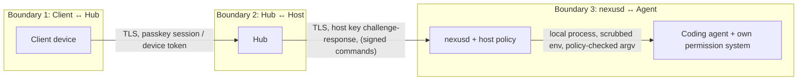
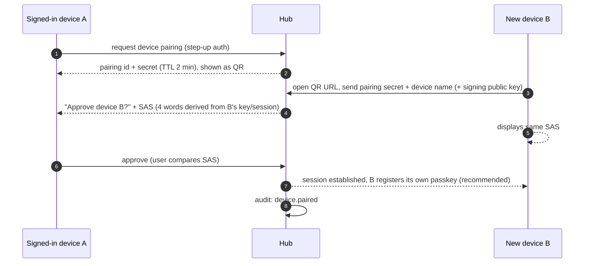
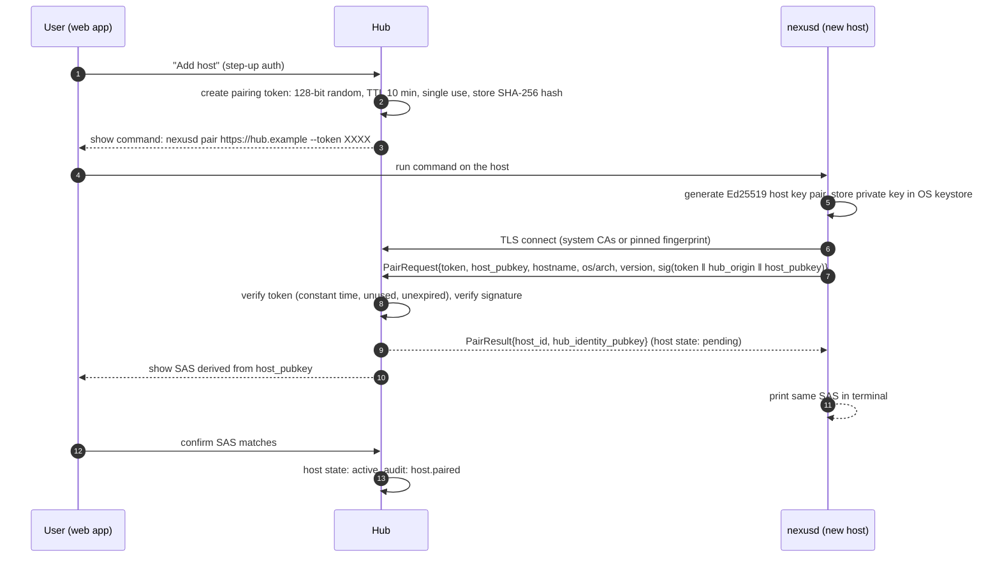

# AgentNexus — Security

AgentNexus lets authenticated users drive coding agents on remote machines. A coding agent can read and modify files and execute commands, so **remote control of an agent is remote code execution**. Security is therefore a core design concern, not an add-on. This document defines the threat model and the security design. Architecture context: [ARCHITECTURE.md §11](ARCHITECTURE.md#11-security-architecture-overview); requirements: [PLAN.md](PLAN.md) (FR-02, FR-40 … FR-46, NFR-01, NFR-02).

> **Status:** design plus implemented subset. The current alpha build implements WebAuthn passkeys, password + optional TOTP, device sessions/revocation, Ed25519 host pairing and challenge-response, host policy, CSRF/Origin checks, hash-chained audit, OpenCode/Codex/ACP approvals, Web Push, multi-user grants, five-minute step-up confirmation for sensitive actions, and replay-protected hub-to-host command signing, and checksum/optional-cosign verified host self-updates. Client/device-signed commands are **not implemented**; host pairing requires SAS confirmation, device (QR) pairing does not yet. Nothing here has received an external audit.

### alpha implementation notes

| Control | Implemented | Gap |
| --- | --- | --- |
| Password login | Argon2id (m=64 MiB, t=3, p=2), min length 10 | no recovery codes or local admin reset command |
| Second factor | Optional TOTP, validated with ±1 time-step | TOTP secret encrypted at rest (see §8); TOTP is not mandatory on non-loopback hubs |
| Passkeys | WebAuthn registration and username-first login, user verification required for step-up | credential JSON is public-key material and is stored unencrypted in `hub.db` |
| Step-up | Sensitive actions require a fresh passkey or password + TOTP confirmation; the window is five minutes and is bound to the session | no per-action confirmation list is configurable yet |
| Sessions | random 256-bit token, SHA-256 hash at rest, `HttpOnly`, `SameSite=Strict`, `Secure` with TLS, 30-day lifetime | cookie is not `__Host-` prefixed because local HTTP development must work; no idle timeout |
| CSRF | custom `X-Nexus-Request` header, `Origin` check, SameSite cookie | no per-session CSRF token |
| Host auth | Ed25519 key generated at pairing, nonce challenge per WebSocket connection, 15 s auth window; hub commands signed and replay-protected after authentication | hub key is a `0600` file, not OS keystore/DPAPI; client/device signatures not implemented |
| Host policy | allowed roots (symlinks resolved), allowed agents, new/fork switches, forbidden flags; enforced on host | no per-action launch profiles |
| Encryption in transit | TLS terminated by the hub or a reverse proxy; outbound WSS | no end-to-end encryption; hub is trusted in the alpha |
| Audit | hash-chained append-only table plus host-local JSONL audit, verification endpoint/UI | host-local log is not hash-chained |
| Device revocation | deletes sessions and closes open browser sockets | push subscriptions are not deleted with the device |
| Rate limiting | login (10 / 5 min per IP+user), pairing (10 / 10 min per IP) | in-memory only, per-process |
| RBAC | owner/admin/member/viewer roles; per-host grants (`view`, `read_transcript`, `resume`, `create`, `fork`, `terminal_input`, `approve`, `manage`) | no invitations, no per-user host ownership UI for members beyond grants |
| Web Push | VAPID, content-free payloads, subscriptions bound to user and device; private key encrypted at rest | permission is browser-controlled |
| Host updates | `nexusd update` downloads releases directly from GitHub, verifies SHA-256 and verifies the cosign keyless bundle when cosign is installed; install is refused while runs are active unless forced | private repository needs a read-only GitHub token; hub does not apply updates |
| Host-link isolation | a host may only emit `run.*` messages for runs whose `host_id` matches its authenticated identity | hub still trusts the host for its own run content |
| Search authorization | federated search and git diff require `read_transcript` on the host | no per-folder transcript scoping |
| Role limits | viewers cannot create host pairing codes | viewers can still read every host explicitly shared with them |
| Windows autostart | per-user Task Scheduler task, logon trigger, least privilege, restart on failure | Server 2025 untested; no boot-time task by design |

**Hardening changes in this build (2026-11-11):**

- `allowed_agents` is now enforced for new terminal sessions and for every
  structured mode; previously only resumed actions were checked.
- One shared session-conflict guard covers terminal, OpenCode, Codex and ACP
  runs, preventing concurrent writers to the same native session.
- The hub rejects `run.*` messages from a host that does not own the run.
- Search and git diff require `read_transcript`; a view-only grant no longer
  exposes transcript snippets or file diffs.
- Terminal resize now requires the controller lease, matching input/prompt.
- Viewers can no longer create host pairing codes.
- The Windows Startup launcher was replaced by a Task Scheduler task with
  crash restart and no administrator rights.
- Hub-to-host commands are signed with an Ed25519 hub identity, nonce and
  timestamp; hosts pin the key and reject replays or stale commands.
- `hub-signing.key`, `secret.key`, `nexusd.json` and the host private key are
  `0600` where the OS supports POSIX permissions.
- Audit appends are serialized so concurrent requests cannot fork the hash
  chain; a concurrent append test verifies the chain.
- TOTP secrets and the VAPID private key are encrypted with AES-256-GCM under a
  `0600` key file next to the database. Legacy plaintext is migrated on startup;
  a missing or damaged key fails closed.
- Attachment names are reduced to a safe basename across both separator styles,
  image and PDF payloads are checked against magic bytes, empty uploads fail,
  failed uploads clean up their directory, and stale directories older than
  24 hours are removed at daemon start.
- Prompt text is capped at 256 KiB and terminal paste input at 2 MiB on both
  hub and host; password input is capped at 1 KiB before Argon2.
- Every agent process is contained in a process tree: Unix runs in their own
  session/process group and receive `SIGTERM` then `SIGKILL`; Windows runs are
  assigned to a Job Object with `JOB_OBJECT_LIMIT_KILL_ON_JOB_CLOSE`. A daemon
  stop terminates every live tree. On Windows the job assignment happens
  immediately after `CreateProcess`; a grandchild spawned in that microsecond
  window could escape the job. The terminal-only alternative (running the
  agent under a wrapper that creates the job first) is not implemented.
- The optional host-local search index is a second copy of transcript text in
  `search-index.db` next to the daemon config. It is created with `0600`
  permissions, never uploaded, and can be disabled with `search_index: false`.
  The hub receives only hit metadata and index progress. Deleting the file or
  running `nexusd index rebuild` removes the local copy.
- HTTP JSON bodies are limited to 1 MiB with `http.MaxBytesReader`, and the
  browser WebSocket read limit is 4 MiB (enough for a 2 MiB terminal paste).
  The host link keeps a 32 MiB limit for paged transcripts.
- Session snapshots are delta-synced after a capability negotiation; full
  snapshots remain the reconnect and repair path.
- Browser WebSocket reconnects use jitter, detect a new hub epoch and replay
  buffered run events from zero after a hub restart.


## Table of contents

1. [Reporting a vulnerability](#1-reporting-a-vulnerability)
2. [Security principles](#2-security-principles)
3. [Threat model](#threat-model)
4. [User authentication](#user-authentication)
5. [Client devices and device pairing](#5-client-devices-and-device-pairing)
6. [Host pairing](#host-pairing)
7. [Host authentication](#host-authentication)
8. [Encryption](#8-encryption)
9. [Authorization and permissions](#9-authorization-and-permissions)
10. [Host policy](#host-policy)
11. [Remote approvals](#11-remote-approvals)
12. [Signed-command mode (Phase 5)](#signed-command-mode-phase-5)
13. [Web security controls](#web-security-controls)
14. [Terminal and content safety](#terminal-and-content-safety)
15. [Secrets and privacy](#15-secrets-and-privacy)
16. [Audit logging](#16-audit-logging)
17. [Supply chain and updates](#supply-chain-and-updates)
18. [Deployment hardening checklist](#18-deployment-hardening-checklist)
19. [Residual risks](#19-residual-risks)
20. [Security testing](#20-security-testing)

---

## 1. Reporting a vulnerability

Please **do not open public issues** for security problems. Report them privately via GitHub's private vulnerability reporting ("Report a vulnerability" in the repository's *Security* tab). Include affected versions, reproduction steps and impact. We aim to acknowledge reports within 7 days and will coordinate a fix and disclosure date with the reporter. Details of unpatched vulnerabilities are not published before a fix is available.

## 2. Security principles

| # | Principle |
| --- | --- |
| SP-1 | **Secure by default** — TLS required off-loopback, no default credentials, all host capabilities disabled until granted. |
| SP-2 | **Defense in depth** — an action must pass hub authentication, hub RBAC, host policy and the agent's own permission system. |
| SP-3 | **Host sovereignty** — the host policy is configured locally on the host and cannot be changed by the hub. |
| SP-4 | **Least privilege** — `nexusd` runs as the normal user, never as root/SYSTEM; agents keep their own sandboxes/permission modes; permission bypass is never added remotely by default. |
| SP-5 | **Minimal data on the hub** — metadata only by default; transcript content stays on hosts. |
| SP-6 | **No agent credentials in AgentNexus** — agents use their own local logins; AgentNexus never reads, stores or transports them. |
| SP-7 | **Everything security-relevant is audited.** |
| SP-8 | **Use proven primitives** — standard library crypto, WebAuthn, TLS; no custom cryptography. |

## Threat model

### 3.1 Assets

| Asset | Where | Impact if compromised |
| --- | --- | --- |
| Ability to send input/approvals to agents | Hub, hosts | Arbitrary code execution as the user on hosts |
| Source code and repositories on hosts | Hosts | Confidentiality/integrity loss |
| Transcripts (may contain secrets, code, business data) | Hosts (hub only if caching enabled) | Confidentiality loss |
| Agent credentials (API keys, OAuth tokens) | Hosts, owned by agents | Account abuse; **out of AgentNexus' reach by design** |
| User credentials, sessions, device keys | Hub, clients | Account takeover |
| Host private keys | Hosts | Host impersonation |
| Audit log | Hub, hosts | Loss of accountability |

### 3.2 Threat actors

- **External attacker** on the internet reaching a publicly exposed hub.
- **Network attacker** (malicious Wi-Fi, compromised router) between clients/hosts and the hub.
- **Malicious or compromised hub** (vulnerability, stolen server, malicious admin of a shared hub).
- **Stolen or lost client device** (phone, laptop).
- **Malicious repository content** (prompt injection that steers the agent toward harmful actions).
- **Malicious local user/process** on a host (other OS users; malware running as the same user is out of scope — it can already do everything the user can).
- **Supply-chain attacker** (compromised dependency, release artifact or agent binary).

### 3.3 Trust boundaries



### 3.4 Threats and mitigations (STRIDE)

| # | Threat | Category | Mitigations |
| --- | --- | --- | --- |
| T-01 | Credential stuffing / brute force on the hub login | Spoofing | Passkeys as primary factor; Argon2id; rate limiting per IP and per account; TOTP for password logins; generic error messages. |
| T-02 | Session hijacking via stolen cookie | Spoofing | `Secure; HttpOnly; SameSite=Strict` cookies, `__Host-` prefix, short idle timeout, binding to device record, revocation; step-up authentication for sensitive actions. |
| T-03 | Pairing code intercepted and used by attacker to register a rogue host | Spoofing | Single-use, 10-minute TTL, stored hashed, bound to creating user; **short authentication string (SAS) confirmation** in the UI before the host becomes active. |
| T-04 | Rogue hub impersonation toward hosts (MITM) | Spoofing | TLS with system trust store or pinned certificate fingerprint established at pairing; host verifies hub identity key on every connection. |
| T-05 | CSRF / cross-site WebSocket hijacking | Tampering | SameSite=Strict cookies, CSRF token on state-changing requests, strict `Origin` check on WebSocket upgrade. |
| T-06 | XSS in the web app (e.g. via transcript content or terminal output) | Tampering / EoP | React escaping, sanitized markdown rendering (no raw HTML), strict CSP without `unsafe-inline` scripts, Trusted Types where supported; terminal output only rendered through xterm.js. |
| T-07 | Malicious hub sends commands to hosts | EoP | Host policy (SP-3) bounds what any command can do; permission bypass forbidden by default; local audit on host; **signed-command mode** removes the hub's ability to forge commands. |
| T-08 | Path traversal / starting agents in arbitrary directories | EoP | Host policy `allowed_roots`; canonicalized paths (symlinks resolved, Windows short names/casing normalized) checked against roots; no shell interpolation — argv arrays only. |
| T-09 | Argument injection into agent command lines (e.g. session ID `--dangerously-skip-permissions`) | EoP | Strict validation of native IDs per agent (UUID/known formats); `--` separators where supported; argv built only by adapters, never from free text. |
| T-10 | Approving a harmful action on a small screen (prompt injection) | EoP | Full command/diff display, risk highlighting, no "always allow" unless policy permits, approval timeouts default-deny, re-authentication for "always allow". |
| T-11 | Lost phone used to control agents | Spoofing | Device revocation; WebAuthn user verification for step-up; short sessions on mobile by default. |
| T-12 | Transcript leakage from hub database/backups | Information disclosure | No transcript persistence on hub by default; secrets encrypted at rest; backup encryption guidance. |
| T-13 | Secrets leaking into logs or push notifications | Information disclosure | Structured logging with redaction; content never logged; push payloads content-free by default. |
| T-14 | Denial of service of hub or hosts (floods, huge transcripts) | DoS | Rate limits, request size limits, per-host/per-run quotas (`max_concurrent_runs`), paged transcripts, backpressure. |
| T-15 | Repudiation of actions ("I didn't approve that") | Repudiation | Hash-chained audit log on hub plus local audit on host; signed commands provide non-repudiation per device. |
| T-16 | Other local OS users reading `nexusd` keys or socket | Information disclosure / EoP | Key storage in OS keystore or `0600` files; no listening sockets except loopback-only ephemeral servers protected by random credentials (OpenCode `serve`); per-user data directories. |
| T-17 | Compromised dependency or release artifact | Tampering | Pinned dependencies, lockfiles, `govulncheck`, signed releases with SBOM, reproducible builds, signature verification on self-update. |
| T-18 | Exposure of agent-side servers (e.g. OpenCode server, Codex app-server WebSocket) | EoP | Only loopback/stdio transports; random port + random password for `opencode serve`; Codex app-server only via stdio; mDNS and CORS never enabled. |

## User authentication

- **Primary:** WebAuthn passkeys (platform or roaming authenticators), user verification **required**. Library: `go-webauthn/webauthn`. Relying-party ID = hub hostname.
- **Fallback:** password (Argon2id, parameters m = 64 MiB, t = 3, p = 1, 16-byte salt; tuned on first start to ≥ 250 ms) **plus** TOTP (RFC 6238) — required for password logins on non-loopback hubs.
- **Recovery:** 10 single-use recovery codes generated at enrollment (stored as Argon2id hashes); owner can additionally reset via local CLI on the hub server (`nexus-hub admin reset-credentials`), which requires shell access to the server.
- **First run:** the hub starts in setup mode bound to loopback only, or prints a one-time setup token to its log/console; the first account becomes `owner`.
- **Sessions:** server-side session records; cookie `__Host-nexus_session`; idle timeout 7 days (desktop) / 24 h (mobile, configurable); absolute lifetime 30 days; rotation on privilege change.
- **Step-up authentication** (passkey/TOTP within the last 10 minutes) for: pairing or revoking hosts, adding devices, changing security settings, user management, enabling "always allow" approvals.
- **Rate limiting:** login attempts per IP and per account with exponential backoff; generic error messages.
- **Optional (Phase 5+):** OIDC login for teams (e.g. against an existing identity provider).

## 5. Client devices and device pairing

Every browser or app that signs in becomes a **client device** record (name, user agent summary, created, last seen, optional signing key). Users can list and revoke devices; revocation invalidates all sessions and push subscriptions of the device immediately.

A device can be added either by signing in with a passkey (including cross-device passkey flows) or by **QR pairing** from an already signed-in device (FR-42):



## Host pairing



- The token never grants anything beyond creating **one pending host** for the issuing user.
- The SAS step defends against a leaked token being redeemed by an attacker first.
- The host pins the hub identity public key returned at pairing; a changed key aborts connections (T-04).
- Re-pairing is required after revocation; there is no silent re-enrollment.

## Host authentication

On every connection (after TLS):

1. Host sends `Hello{host_id, protocol_version, capabilities}`.
2. Hub sends `AuthChallenge{nonce (32 bytes), hub_time, hub_signature}` — the signature with the hub identity key proves the hub's identity to the host independent of the TLS terminator.
3. Host verifies the hub signature against the pinned key and replies `AuthResponse{sig_host("agentnexus-host-auth-v1" ‖ nonce ‖ host_id ‖ hub_origin)}`.
4. Hub verifies against the registered host public key; nonces are single-use and valid for 30 s.

mTLS is intentionally not required so that TLS may terminate at a reverse proxy (ADR-007). Host keys can be rotated (`nexusd rotate-key`: new key signed by the old key, accepted by the hub, old key revoked).

## 8. Encryption

| Data | Protection |
| --- | --- |
| Client ↔ hub, host ↔ hub | TLS 1.3 preferred, TLS 1.2 minimum with AEAD ciphers only; HSTS; the hub refuses to start a non-loopback listener without TLS unless explicitly told it is behind a TLS-terminating proxy (`trusted_proxy` setting with proxy IP allow-list). |
| Hub secrets at rest (TOTP secrets, VAPID private key, push subscription keys, hub identity key) | TOTP secrets and the VAPID private key are encrypted with AES-256-GCM under `secret.key` (`0600`), generated on first start. An encryption error aborts the write; secrets are never silently stored in plaintext. Push subscription keys remain public material. Protects against database-only leaks; back up the database and key together. |
| Optional transcript cache on hub (Q-02) | Encrypted the same way; disabled by default. |
| Hub database and backups | Recommend full-disk encryption on the server; backup command produces an encrypted archive (age/X25519 recipient). |
| Host private key | OS keystore (macOS Keychain, Windows DPAPI/Credential Manager, Linux Secret Service), fallback file `0600` in the user data directory. |
| Host-local cache (metadata, FTS index) | Same protection as the user's home directory (contains data that is already on the host in the agents' own stores); can be disabled. |
| Signed-command payloads (Phase 5) | Ed25519 (or ECDSA P-256 for browsers without Ed25519 in WebCrypto) signatures; integrity and authenticity, not secrecy. |

**End-to-end encryption of transcript content** between host and client (hub only relays ciphertext) is a possible future extension. It is not planned for 1.0 because the web client is served by the hub itself, which limits the protection it can offer (see [§12](#signed-command-mode-phase-5)), and because it would prevent hub-side features such as metadata search. The protocol reserves envelope fields so that it can be added later.

## 9. Authorization and permissions

### 9.1 Roles (hub)

| Capability | owner | admin | member | viewer |
| --- | --- | --- | --- | --- |
| Manage users and roles | ✅ | ✅ (not owner) | — | — |
| Hub settings, audit log | ✅ | ✅ | — | — |
| Pair hosts | ✅ | ✅ | ✅ (own hosts) | — |
| Use hosts | all | all | own + granted | granted (view/read only) |

### 9.2 Per-host permissions

| Permission | Allows |
| --- | --- |
| `view` | See host, agent inventory and session metadata |
| `read_transcript` | Read transcripts and search content |
| `resume` | Resume existing sessions |
| `create` | Start new sessions |
| `fork` | Fork sessions |
| `terminal_input` | Hold the controller lease and send keystrokes/prompts |
| `approve` | Answer approval requests |
| `manage` | Rename/disable/revoke host, edit grants |

Owners of a host implicitly have all permissions on it. Grants are stored on the hub (`HOST_GRANT`, see [ARCHITECTURE.md §8](ARCHITECTURE.md#8-data-model)).

### 9.3 Evaluation order

An action is executed only if **all** of the following allow it:

1. Hub: authenticated user + valid, non-revoked device + (step-up if required).
   Search and git diff require `read_transcript`, not just `view`.
2. Hub: role and per-host permission.
3. Host: host policy (cannot be overridden by the hub).
4. Host (signed-command mode only): valid device signature from a device key trusted by the host.
5. Agent: the agent's own permission/sandbox system (AgentNexus never weakens it by default).

## Host policy

Configured in `<config-dir>/AgentNexus/nexusd.json` on the host. The hub receives
a read-only summary for display. Changes require local file access, are read at
daemon start, and are audited locally.

```json
{
  "policy": {
    "allowed_roots": ["/home/me/code", "/home/me/work"],
    "allowed_agents": ["claude", "codex", "opencode"],
    "allow_new_sessions": true,
    "allow_fork": true,
    "forbidden_args": [
      "--dangerously-skip-permissions",
      "--dangerously-bypass-approvals-and-sandbox",
      "--yolo",
      "--auto-approve"
    ]
  }
}
```

- `allowed_roots` is checked on the host after path canonicalization (symlinks
  resolved) for terminal, structured, ACP and git actions.
- `allowed_agents` is enforced for **new** and resumed sessions in every mode,
  including OpenCode, Codex and ACP structured runs.
- `forbidden_args` rejects permission-bypass flags even if a future hub or
  adapter tries to add them.
- The host never trusts a policy summary sent by the hub. The hub cannot widen
  the local policy.

Defaults on first start: the user's home directory, all detected agents, new
sessions and fork enabled, and the forbidden-argument list above.

## 11. Remote approvals

- Approval requests show: agent, host, project, session, the exact command (with cwd) or file diff, the agent's stated reason, and a risk hint (e.g. network access, deletion, privilege escalation patterns such as `sudo`, `rm -rf`, `curl | sh`).
- Options: **allow once**, **deny**, and — only if `allow_persistent_approvals = true` on the host and after step-up authentication — the agent's own persistent option.
- Unanswered requests are **denied** after a timeout (default 10 min, configurable per host).
- Every request and decision is audited with user, device and timestamp.
- Push notifications for approvals contain no command text by default ("Codex on build-server needs approval").

## Hub command signing

- The hub has a persistent Ed25519 key at `<data-dir>/hub-signing.key` and
  publishes the public key at `GET /api/v1/hub-key`.
- Every post-authentication hub-to-host envelope carries `nonce`, `issued_at`
  and `signature` over a canonical JSON payload with the signature field
  cleared. This covers run control, requests, approvals and session snapshots.
- The host pins the key during pairing, or on first connection for a host
  paired by an older daemon that did not pin one. On every message it verifies:
  - the Ed25519 signature;
  - a timestamp within ?5 minutes;
  - that the nonce has not been seen in the replay window.
- A missing, invalid, stale or replayed command closes the host link and is
  logged. Older hosts that ignore signatures remain compatible; a host with no
  pinned key continues unsigned against an older hub.
- **This does not defend against a compromised hub**, which owns the signing
  key. It defends against command injection/tampering by entities without the
  key and prevents replay. Client/device-signed commands with host-local device
  approval remain the Phase 5 goal below.

## Host update trust chain

- The hub never serves or selects `nexusd` binaries. The host queries GitHub
  releases and downloads the archive and `checksums.txt` directly.
- Every archive is matched against the release checksum; the checksum bundle is
  verified with cosign keyless verification (release workflow identity) when
  cosign is available. `--allow-checksum-only` is an explicit operator choice.
- The daemon publishes `runtime.json` with its active-run count. The updater
  refuses to restart the service while runs are active unless `--force` is
  used. It keeps `nexusd.previous` for rollback and preserves host identity and
  agent configuration.
- A compromised hub cannot inject an executable into this path. A compromised
  GitHub repository/account or a host without cosign (and with
  `--allow-checksum-only`) remains a residual risk.

## Signed-command mode (Phase 5)

Goal: a compromised or malicious hub must not be able to forge control commands.

- Each client device generates a signing key (WebCrypto non-extractable key in IndexedDB for browsers — Ed25519 where the browser supports it, ECDSA P-256 otherwise; OS keystore in native apps).
- **Key trust is established on the host, not on the hub:** when a device key is first used for a host, `nexusd` requires local approval (`nexusd devices approve <fingerprint>` or the tray app). The hub can therefore not inject its own key.
- Control commands (resume, create, input, approval, stop) are signed by the client over a canonical byte payload `{host_id, action, target, params_hash, issued_at, expires_at (≤ 60 s), nonce}`; the hub forwards the exact bytes; the host verifies signature, expiry and nonce uniqueness.
- Terminal keystrokes are batched per signed frame to keep overhead acceptable (to be measured).

**Limitation (documented, risk R-10):** in the web client the JavaScript is delivered by the hub. A compromised hub could serve modified JavaScript that uses the (non-extractable) key to sign malicious commands while the page is open. Full protection therefore requires a native client whose UI code is not loaded from the hub (ADR-013). Signed-command mode still protects against offline or stolen-database attacks and against a hub that is compromised while no browser session is open.

**Status (alpha): not implemented.** The host enforces policy, run uniqueness,
argument filters and hub-command signatures, but it cannot distinguish a command
that a signed-in browser intended from one fabricated by a compromised hub. A
browser-delivered client cannot close that gap because the hub also serves the
JavaScript. A useful future implementation therefore needs either a native
client/extension whose code is not loaded from the hub, or host-local device
approval that shows the exact command before execution. Device keys alone add
non-repudiation but not protection against a compromised hub.

## Web security controls

- **CSP:** `default-src 'self'; script-src 'self'; style-src 'self'; img-src 'self' data:; connect-src 'self' wss://<hub>; frame-ancestors 'self'; base-uri 'none'; form-action 'self'`; Trusted Types where supported.
- **Headers:** HSTS (with `includeSubDomains` when appropriate), `X-Content-Type-Options: nosniff`, `Referrer-Policy: no-referrer`, `Permissions-Policy` restricting unused features, `Cross-Origin-Opener-Policy: same-origin`.
- **CSRF:** SameSite=Strict cookies + synchronizer token for all state-changing requests; WebSocket upgrade requires matching `Origin` and a valid token.
- **CORS:** disabled (same-origin only).
- **Input validation:** OpenAPI schema validation on all requests; size limits (request body default 1 MiB, terminal input frames 64 KiB).
- **Service worker:** caches only the static shell, never API responses or transcripts.

## Terminal and content safety

- Terminal output is rendered only by xterm.js, never injected as HTML.
- OSC 52 clipboard **writes** from the remote side are disabled by default (prevents a malicious program from silently replacing the clipboard); OSC 8 hyperlinks require a confirmation dialog showing the full URL.
- Markdown in chat view is sanitized (no raw HTML, safe link protocols only, images only from the hub origin or as data URLs produced by the host).
- Displayed file paths and commands are shown verbatim in monospace to avoid confusion attacks (bidirectional control characters and homoglyphs highlighted).

## 15. Secrets and privacy

- AgentNexus never reads agent credential files (`~/.claude/.credentials.json`, `~/.codex/auth.json`, OpenCode `auth.json`, …) and excludes them from any discovery scan.
- Child processes receive the user's environment minus AgentNexus' own secrets; adapters may add agent-specific variables only.
- Logs: structured, with a redaction layer for tokens, keys and known secret patterns; conversation content never logged (NFR-13).
- No telemetry (NFR-02). Optional update checks can be disabled.
- Push payloads: event type, host, agent and session title only by default; titles can be hidden too ("privacy mode").
- Data retention: audit log retention configurable (default 365 days); session records of deleted native sessions purged after 30 days.

## 16. Audit logging

- Hub: append-only table with hash chaining (`hash = SHA-256(prev_hash ‖ canonical(event))`); periodic anchor hash written to the log output for external tamper evidence.
- Host: local append-only JSON-lines audit of every command received from the hub (including rejected ones and the reason).
- Events: login success/failure, step-up, device added/revoked, host paired/revoked, policy summary changes, run started/stopped, controller lease changes, input sessions (start/end, not keystroke content), approvals, settings changes, user management.
- Export as JSON lines for SIEM ingestion.

## Supply chain and updates

- Dependencies pinned via `go.sum` and the web lockfile; changes reviewed; automated vulnerability scanning (`govulncheck`, `npm audit`/OSV) and license checks in CI.
- Releases built in CI from tagged commits, with SBOM (SPDX/CycloneDX), checksums and cosign signatures; reproducible build goal.
- macOS notarization and Windows Authenticode signing for `nexusd` (Q-03).
- Optional self-update of `nexusd` verifies signatures before replacing the binary; updates are never forced by the hub.
- AgentNexus never downloads or executes agent binaries (including ACP registry entries) automatically; agents are installed by the user.

## 18. Deployment hardening checklist

- [ ] Prefer topology T1 (private network/VPN) — see [ARCHITECTURE.md §12](ARCHITECTURE.md#12-deployment-topologies).
- [ ] If public: TLS via reverse proxy with automatic certificates, passkeys enforced, optional IP allow-list or additional proxy authentication.
- [ ] Hub runs as an unprivileged user / non-root container with a read-only root filesystem and a single data volume.
- [ ] KEK stored outside the database volume; encrypted backups tested.
- [ ] Host policies reviewed: minimal `allowed_roots`, `forbid_permission_bypass = true`.
- [ ] Unused devices and hosts revoked; audit log reviewed periodically.
- [ ] `nexusd doctor` shows no warnings on every host.

## 19. Residual risks

| ID | Risk | Rating | Notes |
| --- | --- | --- | --- |
| RR-1 | Hub compromise allows controlling hosts within their policies (until signed-command mode is enabled, and partially even then with web clients). | High impact, low likelihood | Mitigated by host policy, private-network deployment, signed-command mode with native clients. Related: [PLAN.md R-04](PLAN.md#14-risk-register). |
| RR-2 | Prompt injection leading to approved harmful actions. | High impact, medium likelihood | Human factor; approval UI design and policies reduce but cannot eliminate it. |
| RR-3 | Agents' own security properties (sandboxing, permission prompts) differ and change over time. | Medium | AgentNexus does not weaken them but cannot strengthen them either. |
| RR-4 | Malware running as the same OS user on a host can use `nexusd`'s key. | High impact | Out of scope; such malware already has the user's privileges. |
| RR-5 | Browser-based key storage weaker than native. | Medium | Documented; native apps for high assurance. |
| RR-6 | Vendor terms of service may restrict some automation patterns. | Legal | Each user uses their own agents and logins on their own machines; re-check before 1.0 ([PLAN.md R-08](PLAN.md#14-risk-register)). |

## 20. Security testing

- Threat model review at the end of Phase 0 and before 1.0.
- Static analysis (`gosec`, CodeQL), dependency scanning, secret scanning on every PR. While the repository is private without GitHub Advanced Security, CodeQL SARIF is uploaded as a workflow artifact instead of to the Security tab.
- Fuzzing of all parsers (transcript parsers, Protobuf/JSON decoders, path canonicalization) with `go test -fuzz`.
- Dedicated tests for: path traversal (incl. Windows UNC, short names, symlinks/junctions), argument injection, CSRF/Origin checks, WebSocket auth, replay of signed commands and auth challenges, rate limiting.
- External penetration test before 1.0 (WP-5.5).
